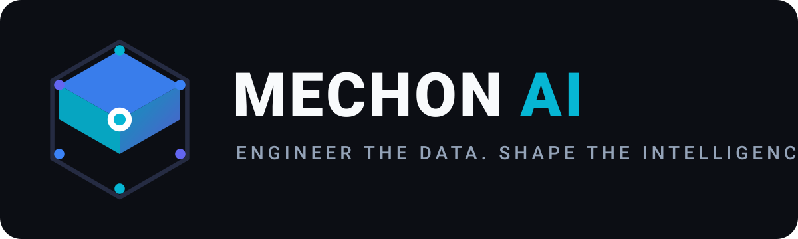

<div align="center">



<br/>

**Engineer the Data. Shape the Intelligence.**

*A local-first desktop AI dataset engineering workstation for creating, curating, validating, and exporting high-quality training datasets for Supervised Fine-Tuning (SFT) and Direct Preference Optimization (DPO).*

[](LICENSE)
[](https://github.com/Mechon-AI/mechon-ai/releases)
[](https://github.com/Mechon-AI/mechon-ai/actions/workflows/ci.yml)
[](https://github.com/Mechon-AI)
[](#installation)
[](#architecture)
[](#architecture)

</div>

---

## Table of Contents

- [1. Why Mechon AI?](#1-why-mechon-ai)
- [2. Feature Matrix](#2-feature-matrix)
- [3. Screenshots](#3-screenshots)
- [4. Architecture](#4-architecture)
- [5. Installation](#5-installation)
- [6. Model Provider Configuration](#6-model-provider-configuration)
- [7. Dataset Workflows](#7-dataset-workflows)
- [8. Dataset Formats & Schema Specification](#8-dataset-formats--schema-specification)
- [9. Security, Privacy & Credential Vault](#9-security-privacy--credential-vault)
- [10. Development & Testing](#10-development--testing)
- [11. Roadmap](#11-roadmap)
- [12. License](#12-license)

---

## 1. Why Mechon AI?

Modern foundation models are shaped by the quality, consistency, and alignment of their training data. However, the existing ecosystem of dataset tools has a critical architectural limitation: **it is almost entirely annotation-first**.

### Annotation-First vs. Creation-First

| Dimension | Annotation-First Tools (Traditional) | Creation-First Engineering (**Mechon AI**) |
| :--- | :--- | :--- |
| **Data Origin** | Assumes raw data already exists (web dumps, logs). | Synthesizes novel, high-density reasoning data from first principles. |
| **Workflow Focus** | Labeling, tagging, bounding boxes, text categorization. | Human-in-the-loop multi-turn drafting, branching, and pairwise rating. |
| **Multi-Turn Structure** | Often flattens dialogue into loose, disconnected rows. | **Atomic conversation commit**: $N$ turns serialized as **one immutable record**. |
| **Model Integration** | Models are treated as external batch labeling scripts. | Native model adapters run directly within the authoring loop. |
| **Multilingual Support** | Manual copy-pasting across disparate translation tools. | **Integrated bilingual review**: Turn-by-turn alignment, regeneration, and bulk approval. |
| **Data Sovereignty** | SaaS platforms requiring data upload to third-party clouds. | **100% Local-First**: Embedded SQLite, offline storage, zero telemetry. |

### The Three Pillars of Mechon AI

1. **Creation**: Interactively craft complex multi-turn dialogues, system instruction boundaries, and synthetic branch variants with live streaming assistance.
2. **Curation**: Perform rigorous pairwise evaluation in DPO Studio, conduct turn-level bilingual auditing, and document human reasoning directly in record metadata.
3. **Engineering**: Validate structural invariants (role alternation, token ratio, prompt overlap), take cryptographic SHA-256 dataset snapshots, and selectively export verified subsets directly into Hugging Face TRL-compliant formats.

---

## 2. Feature Matrix

### Implemented & Stable Features

- **Fine-Tuning Engineering & Certification Suite ("Let the Engineers Control the Quality")**:
  - **Core Engineering Philosophy**: AI can draft, translate, and synthesize, but human engineers retain definitive control over dataset acceptance, truncation policy, and training boundaries.
  - **Model-Aware Chat Template Validation**:
    - Real-time Jinja2 rendering via native `minijinja` for **Meta Llama 3/3.1/3.2/3.3**, **Alibaba Qwen 2.5**, **Google Gemma 2**, **Mistral Instruct**, **Microsoft Phi-3/Phi-4**, and **ChatML Generic**.
    - Generation prompt toggling (`add_generation_prompt`) for assistant turn prefix validation.
    - Role alternation auditing, empty message detection, and raw special token injection scanning (`<|end_of_text|>`, `<|eot_id|>`, `<|im_end|>`, `<end_of_turn>`).
  - **Sequence Length Analytics & Multi-Limit Truncation Impact Matrix**:
    - Model-aware multilingual BPE token estimation across CJK, Arabic, and Latin text scripts.
    - Token percentiles ($P_{50}$, $P_{90}$, $P_{95}$, $P_{99}$), max/min/mean metrics, and 10-interval histogram distribution.
    - Multi-limit comparison matrix (1024, 2048, 4096, 8192, 16384, 32768 tokens) simulating token clipping without mutating underlying records.
  - **Deduplication & Near-Duplicate Review Workbench**:
    - Three-tier deduplication: Exact SHA-256 hashing, Unicode/whitespace normalization, and 3-gram Jaccard index similarity.
    - Interactive cluster inspector with persistent engineer decisions: `Retain` as primary, `Acceptable` intentional variation, or `Exclude` from training partitions.
  - **System Prompt & Persona Audit**:
    - Frequency clustering of system instructions and dominant persona calculations.
    - Contradictory instruction detection and tone drift warnings against explicit policies (`single_consistent_persona`, `multiple_intentional_personas`, `mixed_instruction`).
  - **Train / Eval Splitting with Zero-Leakage Guarantee**:
    - Seeded SplitMix64 deterministic pseudo-random partitioning.
    - Atomic group isolation: Multi-turn conversations and near-duplicate clusters are assigned together, guaranteeing **0 data leakage** between train, validation, and evaluation partitions.
  - **Training Readiness Pre-Flight Certification Report (Flagship)**:
    - Comprehensive 8-dimension pre-flight evaluation classifying dataset readiness into `READY`, `READY_WITH_WARNINGS`, or `BLOCKED`.
    - Mandatory quality gates with actionable engineering recommendations.
    - One-click export to GitHub Flavored Markdown (`.md`) and JSON diagnostics (`.json`).
  - **Conversational DPO Preference Schema (Hugging Face TRL)**:
    - Native support for multi-turn preference schemas: `prompt: [...]`, `chosen: [...]`, and `rejected: [...]`.
    - Direct export to JSON and JSONL formats for seamless consumption by `trl.DPOTrainer`.

- **Subsystem Model Synchronization & Multilingual Translation Pipeline (v1.2.2)**:
  - **Independent Subsystem Model Architecture**: Clear separation of model configurations across Main Inference Engine, Planning Agent, Translation Engine, and Evaluation Agent, with dedicated subsystem model routing and zero cross-leakage.
  - **Multilingual Translation Pipeline**: Selective and full-conversation translation engine with status tracking (`pending`, `completed`, `edited`, `approved`, `failed`), dynamic language pair support, context preservation, and retry mechanisms.
  - **Story Architect UI Refinement**: Relocated conversation composer and Planning Agent workbench into the Right-Side Dock, restoring full height to the Central Narrative Scene Viewport.
  - **Stacking Context & Dropdown Stability**: Fixed popover layering and visual compositing artifacts across Linux desktop and KDE Plasma environments.

- **Modular Desktop Editor Architecture & Narrative Engineering Workstation (v1.2.1)**:
  - Professional IDE design inspired by modern developer workstations and engineering editors.
  - **Story Architect Central Viewport**: 100% dedicated conversation authoring workspace ("Scene View") with chronological dialogue turns, in-place prompt editing, downstream revision invalidation, and live token streaming.
  - **Right-Dock Planning Agent Tab**: Relocated conversation composer, execution autonomy controls (`Manual Review`, `Hybrid Safety`, `Auto-Allow`), planning rationale review, and milestone tracking.
  - **Global Interactive Provider & Model Selector**: Searchable model selection dropdown supporting dynamic model discovery across Google Gemini, Anthropic, OpenAI, Groq, Ollama, and custom endpoints with authoritative inference synchronization.
  - **5-Region Global Editor Shell**:
    - **Main Menu Bar**: Native-grade application menus across `File`, `Edit`, `View`, `Project`, `Tools`, `Window`, and `Help`.
    - **Command & Status Toolbar**: Active project switcher, workspace layout presets, quick save with dirty state tracking, undo/redo, agent monitor, inference model selector, and panel toggles.
    - **Project Explorer (Left Panel)**: Hierarchical tree navigation across active project datasets, core authoring studios, engineering tools, search filter, and pinned favorites.
    - **Multi-Tab Central Workspace**: Multi-tab editing with dirty indicators, context menus, reopen closed tabs, independent editor state, and keep-alive memory management.
    - **Context-Aware Property Inspector (Right Panel)**: Contextual metadata and property editor adapting to selected corpus records, conversations, agent prompts, and provider endpoints.
    - **Collapsible Bottom Panel**: 7-tab diagnostic & monitoring hub (`Console`, `Agent Logs`, `Diagnostics`, `Task Manager`, `Dataset Preview`, `Validation Results`, `Inference Logs`).
  - **Workspace Layout Presets**: Instant switching between *Dataset Engineering*, *Agent Engineering*, *SFT Engineering*, *DPO Evaluation*, *Quality Assurance*, and *Provider Engineering*, plus custom layout saving to local storage.
  - **Global Command Palette (`Ctrl+Shift+P`)**: Search and execute commands via centralized command registry.
  - **Keyboard Shortcuts Engine**: Productivity shortcuts (`Ctrl+S`, `Ctrl+W`, `Ctrl+Tab`, `Ctrl+B`, `Ctrl+J`, `Ctrl+Shift+I`, `F11`, etc.) with input protection.
  - **Dataset Forge**: Document ingestion, semantic chunking, and LLM-assisted dataset synthesis.

- **Mechon Story Architect & Autonomous Conversation Engine ("Plan the Interaction. Engineer the Conversation.")**:
  - **Structured Interaction Planning**: Define comprehensive scenarios, multi-step conversation objectives, user/assistant personas, and phase transitions.
  - **Dual-Agent Autonomous Loop**:
    - **Planning Agent**: Synthesizes structured scenario specifications into actionable prompts aligned with objectives.
    - **Narrative / Task Evaluation Agent**: Analyzes generated assistant turns, tracks objective completion percentages, updates world state, and formulates subsequent conversational prompts.
  - **Deterministic State Machine**: Continuous execution lifecycle: `IDLE → PLANNING → AWAITING_APPROVAL → GENERATING → EVALUATING → UPDATING_CONTEXT → NEXT_PROMPT → GENERATING`.
  - **Supervised Execution Modes**:
    - `Manual Review`: Requires engineer approval for each planned prompt before model execution.
    - `Hybrid Safety`: Automatically executes low-risk prompts and pauses for human verification when narrative branch shifts occur.
    - `Autonomous Turn`: Executes single-step end-to-end cycles with comprehensive diagnostic logs.
  - **In-Flight Conversation Control**: Edit generated prompts prior to submission, or modify historical conversation turns with automatic downstream branch truncation.
  - **Atomic SFT Integration**: Direct one-click commitment of completed multi-turn autonomous scenarios into canonical SFT datasets.

- **Multi-Provider Architecture & 4-Tier Operational Certification**:
  - **Centralized Provider Registry**: Capability-aware adapter design for cloud APIs, local daemons, and inference servers.
  - **Anthropic Claude 5.5 Generation (`claude-haiku-5-5`, `claude-sonnet-5-5`, `claude-opus-5-5`, `claude-fable-5-1`)**:
    - **Model-Aware Sampling Suppression**: Automatically omits `temperature` and `top_p` for Claude 5.5 and reasoning generation models where sampling parameters are deprecated/forbidden, eliminating HTTP 400 parameter errors.
    - **Adaptive Auto-Recovery**: Automatically intercepts client parameter deprecation responses and re-issues generation transparently.
    - **Dynamic Discovery**: Automatic discovery of account-accessible models directly from `/v1/models`.
    - **Message Structure Compliance**: Top-level system prompt extraction, consecutive same-role turn merging, and user-first message sequencing.
  - **OpenAI & OpenAI-Compatible Reasoning Models (`o1`, `o3`, `o4`, DeepSeek-R1, vLLM, LM Studio, SGLang)**:
    - Automatically handles `max_completion_tokens` vs `max_tokens` and converts `system` messages to `developer` messages for reasoning models.
    - URL path normalization supporting custom proxy paths, port variations, and local servers.
    - Extraction of reasoning tokens from `delta.reasoning_content` and `message.thinking`.
  - **Ollama**:
    - Native `/api/chat` and `/api/tags` protocol with host URL sanitization.
    - Detailed token usage metrics extraction (`prompt_eval_count`, `eval_count`).
  - **Google Gemini**:
    - Direct Gemini 2.0 / 2.5 API integration with model prefix normalization and token usage extraction.
  - **4-Tier Operational Diagnostics Suite**:
    - Comprehensive provider verification: Network Connection, Credential Authentication, Model Discovery, Non-Streaming Chat, and Streaming Token SSE.
    - A provider is certified `100% OPERATIONAL` only when all tiers pass.
    - Interactive Diagnostics Modal with latency and token chunk metrics in Provider Manager.

- **Mechon SFT Studio**:
  - Interactive multi-turn dialogue drafting with dynamic system prompt guidance.
  - Streaming LLM completions for assistant turns with configurable sampling parameters.
  - Live turn editing, branching, and downstream turn truncation.
  - **Atomic Record Commitment**: Guarantees an entire multi-turn conversation commits into Mechon Corpus as **exactly one record** with a canonical `messages: [...]` array.
- **Dynamic Multilingual Dataset Engineering**:
  - Dual-mode workspace: **Chat Mode** and **Bilingual / Multilingual Review Mode**.
  - Arbitrary BCP-47 language pairs (e.g. `ja` → `ar`, `id` → `en`, `de` → `fr`, `es` → `ko`, `pt-BR` → `ja`).
  - Searchable `LanguagePicker` with native names, common language prioritization, and custom tag fallback.
  - Native Right-to-Left (RTL) script detection and directionality rendering (`dir="rtl"`) for Arabic, Hebrew, Urdu, Persian, etc.
  - Context-aware LLM translation of all conversation turns.
  - Side-by-side parallel review cards (source on left, translation on right).
  - Turn-level approval lifecycle (`pending` → `generated` → `edited` → `approved` / `failed`).
  - Per-turn editable translations, single-turn context regeneration, and bulk "Approve All Turns".
  - Canonical Schema v2.0 atomic single-record commit preserving full language identity metadata and alignments.
  - Corpus multilingual filtering by active language pairs and badges (`JA → AR`, `ID → EN`).
  - 3 Multilingual export modes: `canonical_aligned`, `primary_only`, and `secondary_only`.
- **Mechon DPO Studio**:
  - Prompt and system prompt input workbench.
  - Concurrent dual candidate generation: Response A and Response B generated in parallel via `tokio::join!`.
  - Independent provider and model selection for candidate A and candidate B (e.g. comparing two distinct models, or the same model with different temperatures).
  - Side-by-side markdown comparison with live token counters and generation parameter badges.
  - Pairwise ranking: Winner (`A` or `B`), `Tie`, or `Flag` for low quality.
  - Keyboard shortcuts (`A`, `B`, `T`, `X`, `S`).
  - Captures human annotator reasoning and rationale directly in record metadata.
- **Mechon Corpus Explorer**:
  - Unified catalog of all committed SFT records and annotated DPO preference tasks.
  - Full-text search and regex filtering.
  - Individual record card multi-select checkboxes, "Select Visible", and "Clear Selection".
  - Floating selection toolbar displaying live selection counts and direct "Export Selected" shortcut.
  - Aligned side-by-side bilingual drawer inspector and raw JSON inspector.
  - Record duplication and atomic deletion.
- **Selective Dataset Export**:
  - Selection-aware Export Center supporting subset exports from Corpus Explorer.
  - Scope toggle: **Entire Corpus** vs. **Selected Examples**.
  - Strict validation rejecting empty selections before file generation.
  - Export formats: **JSON Lines (`.jsonl`)**, **JSON (`.json`)**, and **CSV (`.csv`)**.
  - File integrity reporting with SHA-256 checksums and byte size verification.
- **Model Provider Registry & Native Adapters**:
  - Centralized Provider Registry pattern (no scattered switch-cases).
  - Dedicated native Rust adapters:
    - **Built-in Mock Provider**: 100% offline with zero network requirement for UI testing.
    - **Ollama**: Local daemon (`http://127.0.0.1:11434`) with dynamic model discovery.
    - **Groq**: High-throughput inference with dynamic model discovery.
    - **OpenAI-Compatible Universal Connector**: Compatible with **vLLM**, **LM Studio**, **SGLang**, **LocalAI**, and standard OpenAI `/v1/chat/completions`.
    - **Anthropic Claude**: Compatible with the Anthropic `/v1/messages` API.
  - Provider connection health checks reporting HTTP status codes and round-trip latency.
- **Secure Credential Vault (`HybridCredentialVault`)**:
  - OS-native credential storage via FreeDesktop Secret Service / KDE Wallet (`KWallet`) over D-Bus.
  - Transparent AES-256-GCM encrypted local fallback (`~/.local/share/mechon-ai/vault.enc`) when Secret Service is unavailable or locked.
  - **Zero plaintext API keys stored in SQLite** (`credential_ref` UUID pointer only).
  - Real-time diagnostic probe reporting D-Bus status, write/read-back/delete probes, and UI health indicator.
- **Quality Control & Diagnostics**:
  - Turn role alternation validation (detects consecutive user or assistant messages).
  - Empty turn detection and token length ratio auditing.
  - Prompt overlap detection across the corpus.
- **Dataset Versioning & Snapshots**:
  - Point-in-time immutable version tags with SHA-256 cryptographic hashing.
  - Version comparison and one-click rollback.
- **Storage & Backup**:
  - SQLite with Write-Ahead Logging (`PRAGMA journal_mode=WAL`) and foreign keys enforced.
  - Online atomic `VACUUM INTO` backup and restore.

### Experimental Features

- **High-Concurrency Streaming SSE Parser**: Streaming token rendering under unstable or congested network environments is functional but actively receiving edge-case resilience updates.

### Planned Features

- **Mechon Train**: On-device fine-tuning runner (LoRA and QLoRA) integrated directly with local GPU/ROCm acceleration.
- **Synthetic Data Evolution Engine**: Automated prompt mutation (in-depth, in-breadth, reasoning escalation) based on curated seed datasets.

---

## 3. Screenshots

> [!NOTE]
> *Official application UI screenshots are being curated for the v1.0 release documentation. The placeholders below illustrate the visual workflows.*

```text
+-------------------------------------------------------------------------------------------------+
| docs/screenshots/                                                                               |
| ├── sft-studio.png          # Multi-turn drafting with streaming completion and branching tree   |
| ├── bilingual-review.png    # Side-by-side Indonesian/English review cards with status badges   |
| ├── dpo-studio.png          # Dual-candidate pairwise evaluation with token counters and hotkeys|
| ├── corpus-explorer.png     # Corpus table with multi-select checkboxes and bilingual drawer     |
| ├── export-center.png       # Scope selector (Selected vs Entire) and live JSONL preview        |
| └── provider-vault.png      # Provider management, latency tests, and KWallet diagnostics probe  |
+-------------------------------------------------------------------------------------------------+
```

---

## 4. Architecture

Mechon AI uses a **100% native desktop architecture**. There is **zero Python required at runtime or build time**.

```mermaid
graph TD
    subgraph Frontend ["Frontend Shell (React 18 + TypeScript + Vite 6)"]
        UI_Dashboard["Dashboard & Workspace"]
        UI_SFT["Mechon SFT Studio<br/>Chat, Bilingual & Revision"]
        UI_DPO["Mechon DPO Studio<br/>Pairwise Evaluation"]
        UI_Story["Story Architect<br/>Planning & Agentic Authoring"]
        UI_Corpus["Mechon Corpus<br/>Explorer & Dataset Inspector"]
        UI_Export["Export Center<br/>Selective & Multilingual Export"]
        UI_Providers["Provider Manager<br/>Registry & Diagnostics"]
        UI_Engineering["Dataset Engineering<br/>Quality, Deduplication & Analytics"]
        UI_Layout["Workspace Layout Manager<br/>Resizable Panels & Persistent Ratios"]
        UI_State["Zustand Stores & TanStack Query"]
    end

    subgraph IPC ["Tauri 2 Native IPC Boundary"]
        Bridge["Type-Safe Tauri Commands"]
        Events["Tauri Event Bus<br/>Streaming, Progress & Agent Events"]
    end

    subgraph Rust_Core ["Native Rust Backend Core"]

        subgraph Authoring ["Dataset Authoring Services"]
            Svc_SFT["SFT Service<br/>Session & Atomic Commits"]
            Svc_DPO["DPO Service<br/>Dual Generation & Annotation"]
            Svc_Story["Story Planning Service<br/>Premise, Characters & Objectives"]
            Svc_Conversation["Conversation Engine<br/>Multi-Turn Context & Execution"]
            Svc_Revision["Revision Service<br/>Edit, Regenerate & Restore"]
        end

        subgraph Agentic ["Agentic Dataset Engineering Engine"]
            Planner["Planning Agent<br/>Story-to-Prompt Generation"]
            Context["Narrative Context Manager<br/>Continuity & Ground Truths"]
            Evaluator["Progress Evaluation Agent<br/>Milestone & Objective Tracking"]
            Approval["Human-in-the-Loop Controller<br/>Manual / Hybrid / Auto-Allow"]
            Orchestrator["Agent Orchestrator<br/>Autonomous Execution Loop"]
            Provenance["Agent Provenance Tracker<br/>Prompt & Generation History"]
        end

        subgraph Provider_System ["Model Provider Orchestration"]
            Config["Authoritative Provider Config<br/>Provider & Model Resolution"]
            Router["Provider Router<br/>Request Dispatch & Session Overrides"]
            Registry["Provider Registry"]
            Capabilities["Model Capability Registry<br/>Parameters & Protocol Support"]
            Diagnostics["Provider Diagnostics<br/>Health, Auth & Generation Tests"]
            Retry["Error & Retry Manager<br/>429, Timeout & Recovery"]

            Mock["Mock Adapter"]
            Ollama["Ollama Adapter"]
            Groq["Groq Adapter"]
            OpenAI["OpenAI-Compatible Adapter"]
            Anthropic["Anthropic Messages Adapter"]
            Streaming["Unified Streaming Engine<br/>Provider-Specific SSE Parsers"]
        end

        subgraph Data_Engineering ["Dataset Engineering Services"]
            Dataset["Dataset Service<br/>Corpus & Record Management"]
            Translation["Translation Service<br/>Dynamic Language Pairs"]
            Export["Export Service<br/>JSONL, JSON, CSV & TXT"]
            Validation["Quality Validation Service<br/>Schema & Structural Audits"]
            Dedup["Deduplication Engine"]
            Analytics["Sequence & Dataset Analytics"]
            Versioning["Dataset Versioning<br/>SHA-256 Snapshots & Rollback"]
        end

        subgraph Security ["Security & Credential Vault"]
            Vault["HybridCredentialVault"]
            Secret["FreeDesktop Secret Service / KWallet"]
            AES["AES-256-GCM Encrypted Fallback"]
        end

        subgraph Storage ["Persistent Storage"]
            Pool["SQLx Connection Pool<br/>WAL & Foreign Keys"]
            DB[("SQLite Database")]
            FileStore["Local Dataset & Backup Storage"]
        end
    end

    UI_Dashboard --> Bridge
    UI_SFT --> Bridge
    UI_DPO --> Bridge
    UI_Story --> Bridge
    UI_Corpus --> Bridge
    UI_Export --> Bridge
    UI_Providers --> Bridge
    UI_Engineering --> Bridge
    UI_Layout --> Bridge

    Bridge --> Svc_SFT
    Bridge --> Svc_DPO
    Bridge --> Svc_Story
    Bridge --> Svc_Conversation
    Bridge --> Svc_Revision
    Bridge --> Dataset
    Bridge --> Translation
    Bridge --> Export
    Bridge --> Validation
    Bridge --> Diagnostics

    Svc_Story --> Planner
    Planner --> Context
    Context --> Evaluator
    Evaluator --> Approval
    Approval --> Orchestrator
    Orchestrator --> Svc_Conversation
    Svc_Conversation --> Planner

    Orchestrator --> Provenance
    Svc_Conversation --> Provenance
    Svc_Revision --> Provenance

    Approval --> Events
    Orchestrator --> Events
    Streaming --> Events
    Events --> UI_State

    Svc_SFT --> Router
    Svc_DPO --> Router
    Translation --> Router
    Planner --> Router
    Svc_Conversation --> Router
    Svc_Revision --> Router

    Config --> Router
    Router --> Registry
    Registry --> Capabilities
    Registry --> Mock
    Registry --> Ollama
    Registry --> Groq
    Registry --> OpenAI
    Registry --> Anthropic

    Registry --> Streaming
    Router --> Retry
    Router --> Vault
    Diagnostics --> Registry

    Svc_SFT --> Dataset
    Svc_Conversation --> Dataset
    Svc_Revision --> Dataset
    Dataset --> Validation
    Dataset --> Dedup
    Dataset --> Analytics
    Dataset --> Versioning
    Dataset --> Export

    Translation --> Dataset
    Validation --> Versioning
    Versioning --> FileStore
    Export --> FileStore

    Router --> Pool
    Svc_SFT --> Pool
    Svc_DPO --> Pool
    Svc_Story --> Pool
    Svc_Conversation --> Pool
    Svc_Revision --> Pool
    Dataset --> Pool
    Translation --> Pool
    Versioning --> Pool
    Pool --> DB

    Vault --> Secret
    Vault --> AES
```



For full architectural specifications, see [docs/ARCHITECTURE.md](docs/ARCHITECTURE.md).

---

## 5. Installation

Mechon AI is designed primarily for **Linux** workstations, with dedicated packaging for **Arch Linux**, **Debian/Ubuntu**, and portable binary tarballs.

### Arch Linux / EndeavourOS / Manjaro / CachyOS (Primary Platform)

Mechon AI provides a validated, native `PKGBUILD` that always pulls and compiles the latest commit from git:

```bash
# Clone the repository
git clone https://github.com/Mechon-AI/mechon-ai.git
cd mechon-ai/packaging/arch

# Compile and install the latest commit
makepkg -si
```

*Or download the PKGBUILD standalone and build directly:*
```bash
curl -LO https://raw.githubusercontent.com/Mechon-AI/mechon-ai/main/packaging/arch/PKGBUILD
curl -LO https://raw.githubusercontent.com/Mechon-AI/mechon-ai/main/packaging/arch/mechon-ai.desktop
makepkg -si
```

### Portable Binary Tarball (All Linux Distributions)

Download the official standalone release from [GitHub Releases](https://github.com/Mechon-AI/mechon-ai/releases):

```bash
wget https://github.com/Mechon-AI/mechon-ai/releases/download/v1.1.1/mechon-ai-v1.1.1-linux-x86_64.tar.gz
tar -xzvf mechon-ai-v1.1.1-linux-x86_64.tar.gz
cd mechon-ai-v1.1.1-linux-x86_64
./mechon-ai
```

### Compiling From Source Manually

#### System Prerequisites

- **Arch Linux**:
  ```bash
  sudo pacman -S --needed base-devel rust cargo nodejs npm webkit2gtk-4.1 gtk3 openssl sqlite pkgconf
  ```
- **Ubuntu / Debian**:
  ```bash
  sudo apt-get install -y build-essential curl pkg-config libwebkit2gtk-4.1-dev libgtk-3-dev libayatana-appindicator3-dev librsvg2-dev libssl-dev libsqlite3-dev
  ```

#### Build Commands

```bash
# 1. Clone repository
git clone https://github.com/Mechon-AI/mechon-ai.git
cd mechon-ai

# 2. Automated setup
./scripts/setup.sh

# 3. Compile release executable
./scripts/build.sh
```
The compiled native executable will be generated at `src-tauri/target/release/mechon-ai`.

---

## 6. Model Provider Configuration

Mechon AI allows connecting multiple AI backends simultaneously without restarting the application.

### Supported Providers

| Provider | Type Identifier | Default Base URL | Capabilities |
| :--- | :--- | :--- | :--- |
| **Offline Mock LLM** | `mock` | *None (In-process)* | Offline prototyping, UI testing, instant completions. |
| **Ollama** | `ollama` | `http://127.0.0.1:11434` | Local inference, auto-discovery of pulled models. |
| **Groq** | `groq` | `https://api.groq.com/openai/v1` | Ultra-fast cloud inference, dynamic model discovery. |
| **OpenAI-Compatible** | `openai` | Customizable (e.g. `http://localhost:8000/v1`) | Universal adapter for vLLM, LM Studio, SGLang, LocalAI. |
| **Anthropic Claude** | `anthropic` | `https://api.anthropic.com` | Claude 3.5 Sonnet, Claude 3 Opus via `/v1/messages`. |

### Configuring a Provider

1. Open **Provider Manager** from the left navigation bar.
2. Click **Add Provider** and select the provider type.
3. Configure the **Base URL** (or leave default for Ollama / Groq / Anthropic).
4. Enter your **API Key**:
   - The key is saved immediately to the **OS Credential Vault** (KDE Wallet / FreeDesktop Secret Service).
   - Plaintext keys are **never** written to the SQLite database.
   - The UI displays only a masked hint (e.g. `••••••••9900`).
5. Click **Test Connection**: Mechon AI verifies network connectivity, API key authorization, and model discovery.
6. Select your **Default Model** from the dynamically populated dropdown list.

---

## 7. Dataset Workflows

### Workflow 1: Supervised Fine-Tuning (SFT)

```text
[Create Session] ──> [Draft Multi-Turn Dialogue] ──> [Edit / Truncate Turns] ──> [Atomic Commit] ──> [Mechon Corpus] ──> [Export JSONL]
```

1. **Create Drafting Session**: Define session title, system prompt, and target model.
2. **Author Dialogue**: Add user prompts and stream assistant responses from the active model.
3. **Refine & Branch**: Edit any previous turn in-place; truncate downstream turns if a new conversation direction is desired.
4. **Commit Atomically**: Commit the draft into the project dataset. The conversation commits as **exactly one atomic record** with the entire messages array intact.

---

### Workflow 2: Bilingual Dataset Engineering (ID ↔ EN)

```text
[Draft Primary Dialogue] ──> [Generate LLM Translation] ──> [Bilingual Review Studio] ──> [Turn Approval & Edits] ──> [Commit Aligned Record] ──> [Projected Export]
```

1. **Draft in Primary Language**: Author the multi-turn conversation in your primary language (e.g. Indonesian).
2. **Generate Translation**: Click **Generate Translation**. Mechon AI’s contextual translation engine translates each turn sequentially, maintaining conversational grounding and persona.
3. **Switch to Bilingual Review Studio**: Inspect the side-by-side cards (Indonesian on the left, English on the right).
4. **Turn-Level Auditing**:
   - Edit translations directly in the textarea.
   - Click **Save & Approve** to mark individual turns as `approved`.
   - Click **Regenerate Turn** to re-prompt the translation model with conversational context.
   - Click **Approve All Turns** once verified.
5. **Commit Aligned Record**: Commit the session into Mechon Corpus. The record preserves both languages turn-by-turn with verification statuses.
6. **Export**: Export as `canonical_aligned`, `primary_only`, or `secondary_only`.

---

### Workflow 3: Direct Preference Optimization (DPO)

```text
[Input Prompt] ──> [Dual-Model Synthesis] ──> [Side-by-Side Comparison] ──> [Annotate Winner/Tie/Flag] ──> [TRL-Compliant Export]
```

1. **Create Task**: Input the prompt instruction and optional system prompt.
2. **Synthesize Candidates**:
   - Model A generates Candidate A.
   - Model B generates Candidate B (runs in parallel via `tokio::join!`).
3. **Evaluate Side-by-Side**: Inspect markdown renderings, token lengths, and generation latencies.
4. **Annotate**:
   - Press <kbd>A</kbd> to designate Candidate A as chosen.
   - Press <kbd>B</kbd> to designate Candidate B as chosen.
   - Press <kbd>T</kbd> for Tie, or <kbd>X</kbd> to Flag low-quality generations.
   - Enter annotator rationale to document why the winner was selected.
5. **Export**: Export preference pairs to standard format (`prompt`, `chosen`, `rejected`).

---

## 8. Dataset Formats & Schema Specification

Mechon AI natively supports **JSON Lines (`.jsonl`)**, **JSON (`.json`)**, and **CSV (`.csv`)**.

### Canonical SFT Record (JSONL)

```json
{
  "id": "e4b29c18-9a4f-4d32-b7e1-8f5c3a290d11",
  "project_id": "c1a8d052-7e3f-4890-a59e-1148e69efb32",
  "title": "Quantum Computing Fundamentals",
  "language_mode": "bilingual",
  "primary_language": "id",
  "secondary_language": "en",
  "messages": [
    {
      "id": "msg-001",
      "role": "system",
      "content": "Anda adalah asisten AI yang ahli dalam fisika kuantum.",
      "translations": { "en": "You are an AI assistant specialized in quantum physics." },
      "translation_status": { "en": "approved" }
    },
    {
      "id": "msg-002",
      "role": "user",
      "content": "Jelaskan konsep dasar superposisi kuantum dalam satu paragraf.",
      "translations": { "en": "Explain the fundamental concept of quantum superposition in one paragraph." },
      "translation_status": { "en": "approved" }
    },
    {
      "id": "msg-003",
      "role": "assistant",
      "content": "Superposisi kuantum adalah prinsip mekanika kuantum di mana sebuah partikel dapat berada dalam beberapa keadaan sekaligus sebelum dilakukan pengukuran.",
      "translations": { "en": "Quantum superposition is a principle of quantum mechanics where a particle can exist in multiple states simultaneously before measurement." },
      "translation_status": { "en": "approved" }
    }
  ],
  "metadata": { "turn_count": 3, "verified": true },
  "created_at": "2026-11-03T08:15:00Z"
}
```

### Canonical DPO Record (JSONL)

```json
{
  "id": "dpo-8821fa0c-512a-4ce7-bb91-03829031ef82",
  "project_id": "c1a8d052-7e3f-4890-a59e-1148e69efb32",
  "prompt": "Tuliskan implementasi fungsi binary search rekursif di Rust.",
  "chosen": "Berikut adalah implementasi binary search rekursif yang idiomatik di Rust:\n\n```rust\npub fn binary_search<T: Ord>(slice: &[T], target: &T) -> Option<usize> { ... }\n```",
  "rejected": "Ini kodenya:\n\n```rust\nfn search(arr: Vec<i32>, x: i32) -> i32 { ... }\n```",
  "metadata": {
    "model_a": "claude-3-5-sonnet-20241022",
    "model_b": "llama-3.1-8b-instruct",
    "winner": "A",
    "rationale": "Response A menyediakan algoritma binary search generic yang aman terhadap integer overflow.",
    "is_flagged": false
  },
  "created_at": "2026-11-03T07:20:00Z"
}
```

For complete schema details and CSV mappings, see [docs/DATA_FORMATS.md](docs/DATA_FORMATS.md).

---

## 9. Security, Privacy & Credential Vault

- **Local-First Isolation**:
  - All dataset records, session drafts, snapshots, and database transactions reside strictly on the local machine.
  - Zero telemetry, analytics beacons, or remote tracking pings.
- **Credential Storage**:
  - API credentials are stored via the **FreeDesktop Secret Service API** (KDE Wallet / GNOME Keyring) through D-Bus.
  - If Secret Service is locked or unavailable, credentials fallback to a local AES-256-GCM encrypted vault (`~/.local/share/mechon-ai/vault.enc`).
  - **No plaintext API keys are ever stored in SQLite**. The database stores only a random UUID pointer (`credential_ref`).
- **Network Transparency**:
  - Mechon AI initiates network traffic **only** when the user explicitly triggers a remote model completion (e.g. calling Groq or Anthropic APIs).
  - When using local Ollama or the built-in Mock provider, zero external network traffic occurs.

---

## 10. Development & Testing

### Project Layout

```text
mechon-ai/
├── src-tauri/                 # Native Rust backend (Tauri 2 Core)
│   ├── src/
│   │   ├── commands/          # Type-safe Tauri IPC command handlers
│   │   ├── credentials/       # Secret Service & AES-256-GCM Hybrid Credential Vault
│   │   ├── database/          # SQLx SQLite pool & migrations
│   │   ├── models/            # Domain entities and DTOs
│   │   ├── providers/         # Model Provider Registry & Adapters
│   │   ├── services/          # Core business services (SFT, DPO, Export, Translation)
│   │   ├── validation/        # Dataset Quality Control validators
│   │   ├── lib.rs             # Tauri application builder & command registration
│   │   └── main.rs            # Desktop entrypoint
│   ├── migrations/            # SQLx schema migrations
│   └── tests/                 # Rust unit and integration test suites
│
├── frontend/                  # React 18 + Vite 6 + TypeScript desktop shell
│   └── src/
│       ├── components/        # Reusable UI components & layouts
│       ├── features/          # Feature workspaces (SFT, DPO, Corpus, Export, Providers)
│       ├── services/          # Tauri IPC client bindings
│       ├── stores/            # Zustand state management (Selection, Layout)
│       └── types/             # TypeScript domain definitions
│
├── packaging/                 # Distribution manifests (Arch Linux PKGBUILD, Debian, RPM)
├── scripts/                   # Automated build, test, setup, and dev scripts
└── docs/                      # Architectural specifications & guides
```

### Essential Commands

```bash
# Automated setup (checks toolchains, installs frontend packages)
./scripts/setup.sh

# Launch development environment (Vite hot-reload + Tauri desktop)
./scripts/dev.sh

# Run complete automated test suite (Rust unit/integration tests + frontend build)
./scripts/test.sh

# Build production release binary
./scripts/build.sh
```

---

## 11. Roadmap

- [x] Architecture rebuild to native Rust + Tauri 2 + SQLite (zero Python runtime).
- [x] Provider Registry Pattern with native adapters (Ollama, Groq, OpenAI, Anthropic, Mock).
- [x] FreeDesktop Secret Service / KDE Wallet integration with encrypted fallback.
- [x] SFT Multi-Turn Studio with atomic conversation commitment.
- [x] DPO Pairwise Evaluation Studio with dual-model parallel synthesis.
- [x] Selective Dataset Export with empty-selection validation.
- [x] Dynamic Multilingual Dataset Architecture (arbitrary BCP-47 pairs, RTL script support, Canonical Schema v2.0).
- [x] Official Arch Linux packaging (`PKGBUILD`) in compilation mode.
- [x] Automated GitHub Actions CI/CD release workflow.
- [ ] **Mechon Train**: On-device LoRA / QLoRA fine-tuning engine using local GPUs. *(Planned)*
- [ ] **Synthetic Data Evolution Engine**: Multi-turn reasoning escalation algorithms. *(Planned)*
- [ ] **GGUF / Llama.cpp Direct In-Process Runtime**: Zero-dependency local inference without external daemons. *(Planned)*

---

## 12. License

Mechon AI is open source software licensed under the **Apache License, Version 2.0**.

See the full license text in the [LICENSE](LICENSE) file.

```text
Copyright 2026 Mechon AI Team <cemetery394@gmail.com>

Licensed under the Apache License, Version 2.0 (the "License");
you may not use this file except in compliance with the License.
You may obtain a copy of the License at

    http://www.apache.org/licenses/LICENSE-2.0
```
