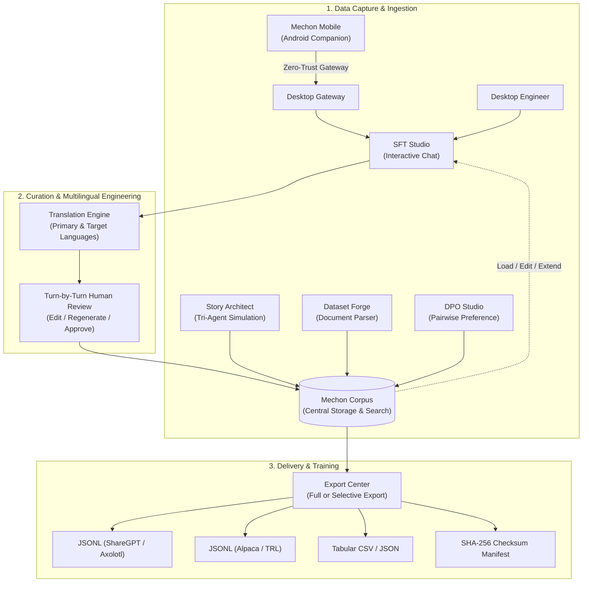

<div align="center">


<br/>

**Engineer the Data. Shape the Intelligence.**

*A local-first AI Dataset Engineering Workstation for creating, curating, translating, evaluating, and exporting high-quality training datasets for language model alignment.*

[](LICENSE)
[](https://github.com/Mechon-AI/mechon-ai/releases)
[](CHANGELOG.md)
[](#platform-support)
[](#platform-support)
[](#platform-support)

</div>

---

## 1. Why Mechon AI?

State-of-the-art language model alignment requires more than raw web scrapes or generic data annotation tools. Fine-tuning models for multi-turn chat, nuanced roleplay, step-by-step reasoning, and domain-specific instruction adherence demands **high-context conversational data** engineered with intent.

**Mechon AI** is an integrated desktop workstation and mobile companion designed for dataset engineers. It replaces fragmented scripts, ad-hoc API notebooks, and spreadsheet annotators with a local-first engineering environment where you can interactively converse with models, orchestrate agentic narrative simulations, translate conversations across languages, annotate preference pairs, and export verified datasets directly into training pipelines.

---

## 2. Main Feature Overview

- **Interactive Multi-Turn SFT Studio**: Converse freely with local or cloud LLMs, edit message turns, regenerate responses, and commit multi-turn dialogues as atomic training records.
- **Story Architect (Tri-Agent Simulation)**: Automated narrative and roleplay conversation generation orchestrated by three specialized agents: Planning, Inference, and Evaluation.
- **Multilingual Translation Engine**: Integrated LLM-driven translation with turn-by-turn side-by-side editing, regeneration, and parallel multi-language dataset export.
- **Mechon Corpus**: Central dataset repository with a bidirectional bridge—load any saved record back into SFT Studio to edit, extend, re-translate, and recommit.
- **DPO Studio**: Side-by-side candidate comparison, winner/tie/flag selection, and human rationale tagging for preference alignment.
- **Dataset Forge (Document Parser)**: Transform unstructured documents and source code into semantic chunks and conversational SFT pairs.
- **Mechon Mobile Companion**: Native Android companion (`ai.mechon.companion`) for remote conversation authoring over LAN or Tailscale, with standalone `@Web Search`.
- **Local-First & Zero Telemetry**: Embedded SQLite WAL storage and OS-native credential vaults (Secret Service / KWallet); your proprietary data and API keys never leave your control.

---

## 3. The Dataset Engineering Lifecycle



---

## 4. Workstations & Studio Components

### A. SFT Studio
SFT Studio treats conversations as **atomic multi-turn records**. Engineers configure system prompts, model hyper-parameters, and language modes. During dialogue, curators can edit any message, truncate downstream trajectories, regenerate turns, and trigger the integrated **Translation Engine** to produce parallel multilingual versions before committing to Corpus.  
*Documentation: [docs/SFT_STUDIO.md](docs/SFT_STUDIO.md)*

### B. Story Architect
An agentic conversation engineering environment designed for complex roleplay and narrative datasets. Story Architect employs a **Tri-Agent architecture**:
1. **Planning Agent**: Formulates narrative beats, tracks milestones, and generates the next prompt.
2. **Inference Model**: Generates the in-character story progression and dialogue.
3. **Evaluation Agent**: Quantitatively scores Persona Consistency, Objective Progress, and Synthesis Quality.

Supports both **Manual Approval** and autonomous **Auto-Allow** execution loops. Completed stories can be committed directly to Corpus or opened in SFT Studio for multilingual expansion.  
*Documentation: [docs/STORY_ARCHITECT.md](docs/STORY_ARCHITECT.md)*

### C. Mechon Corpus
The central dataset intelligence hub. Search, filter, and inspect complete multi-turn conversations and preference pairs. Because dataset engineering is iterative, Corpus includes a **bidirectional studio bridge**: select any record, click *Load into SFT Studio*, extend the conversation with new turns, and recommit the updated record.  
*Documentation: [docs/CORPUS_AND_EXPORT.md](docs/CORPUS_AND_EXPORT.md)*

### D. Export Center
Transform Corpus records into standardized training formats, including **ShareGPT JSONL**, **Alpaca JSONL**, **DPO JSONL**, **JSON**, and **CSV**. Features **Selective Export** (export only chosen records) and automatically generates **SHA-256 checksum manifests** for cryptographic dataset integrity verification on GPU clusters.  
*Documentation: [docs/DATA_FORMATS.md](docs/DATA_FORMATS.md)*

### E. DPO Studio
Author preference pairs for Direct Preference Optimization and RLHF. Configure independent models for Candidate A and Candidate B, generate parallel completions, compare outputs side-by-side, assign preference decisions (Chosen, Rejected, Tie, Flag), and record human evaluation rationales.  
*Documentation: [docs/DPO_STUDIO.md](docs/DPO_STUDIO.md)*

### F. Dataset Forge (Document Parser)
Ingest source documents, text, and code. Semantic chunking algorithms partition content with token estimation, while configured LLMs synthesize structured question-and-answer SFT candidate pairs for human review and Corpus commitment.

### G. Mechon Mobile Companion
A native Android client (`ai.mechon.companion`) enabling engineers to create conversational data away from the desktop. Connects securely via local Wi-Fi UDP discovery (port 38476) or Tailscale mesh. Android inherits the desktop's configured providers and credentials, runs standalone `@Web Search`, and transfers mobile sessions directly into the desktop SFT pipeline.  
*Documentation: [docs/MECHON_MOBILE.md](docs/MECHON_MOBILE.md)*

---

## 5. Platform Support

| Component | Platform | Technology Stack | Distribution |
|---|---|---|---|
| **Desktop Workstation** | Linux (Arch, Ubuntu, Debian, Fedora) | Rust 2021, Tauri 2, React 18, Vite 6, SQLite WAL | Native Arch package (`PKGBUILD`), AppImage, Tarball |
| **Mobile Companion** | Android 14+ (API 34+) | Kotlin, Jetpack Compose, Material 3, OkHttp | Release APK (16 KB page-size ready) |

---

## 6. Supported Model Providers

Mechon AI features a vendor-neutral inference layer with automatic canonical alias normalization:

- **Local / Offline**: [Ollama](https://ollama.com/) (100% offline, local GPU inference)
- **Cloud Providers**: Google Gemini, Anthropic Claude, OpenAI, Groq (ultra-low latency LPU), Mistral AI, OpenRouter
- **Self-Hosted**: Any OpenAI-compatible endpoint (vLLM, TGI, LM Studio, LocalAI)

API credentials are encrypted in the **OS-native Secret Service / KDE KWallet** via D-Bus, backed by an AES-256-GCM hardware-derived fallback.  
*Documentation: [docs/PROVIDERS.md](docs/PROVIDERS.md)*

---

## 7. Documentation Index

- [User Guide](docs/USER_GUIDE.md) — Comprehensive user guide and studio workflows
- [Architecture Specification](docs/ARCHITECTURE.md) — Technical architecture, Rust core, and storage
- [SFT Studio Guide](docs/SFT_STUDIO.md) — Multi-turn conversation curation & translation
- [Story Architect Guide](docs/STORY_ARCHITECT.md) — Tri-Agent narrative simulation & prompt planning
- [Corpus & Export Guide](docs/CORPUS_AND_EXPORT.md) — Central dataset workspace & selective export
- [DPO Studio Guide](docs/DPO_STUDIO.md) — Pairwise preference dataset generation
- [Mechon Mobile Guide](docs/MECHON_MOBILE.md) — Android setup, Tailscale mesh & LAN pairing
- [Model Providers](docs/PROVIDERS.md) — Supported engines, endpoints, and credential storage
- [Dataset Formats](docs/DATA_FORMATS.md) — Schema specifications for ShareGPT, Alpaca, and DPO
- [Security & Privacy](docs/SECURITY.md) — Zero-telemetry, encryption, and authorization architecture
- [Development Guide](docs/DEVELOPMENT.md) — Building, testing, and packaging from source

---

## 8. Development Quick Start

### Desktop Workstation
```bash
# Clone the repository
git clone https://github.com/Mechon-AI/mechon-ai.git
cd mechon-ai

# Install dependencies and start desktop dev server
cd frontend && npm install
cd ..
npm run tauri dev
```

### Android Companion
```bash
cd android
./gradlew testDebugUnitTest assembleDebug
```

---

## 9. License

Mechon AI is open-source software licensed under the **[Apache License 2.0](LICENSE)**.
