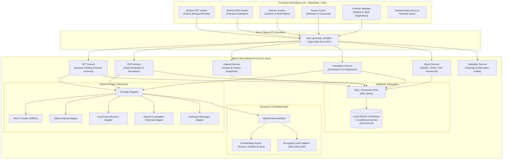
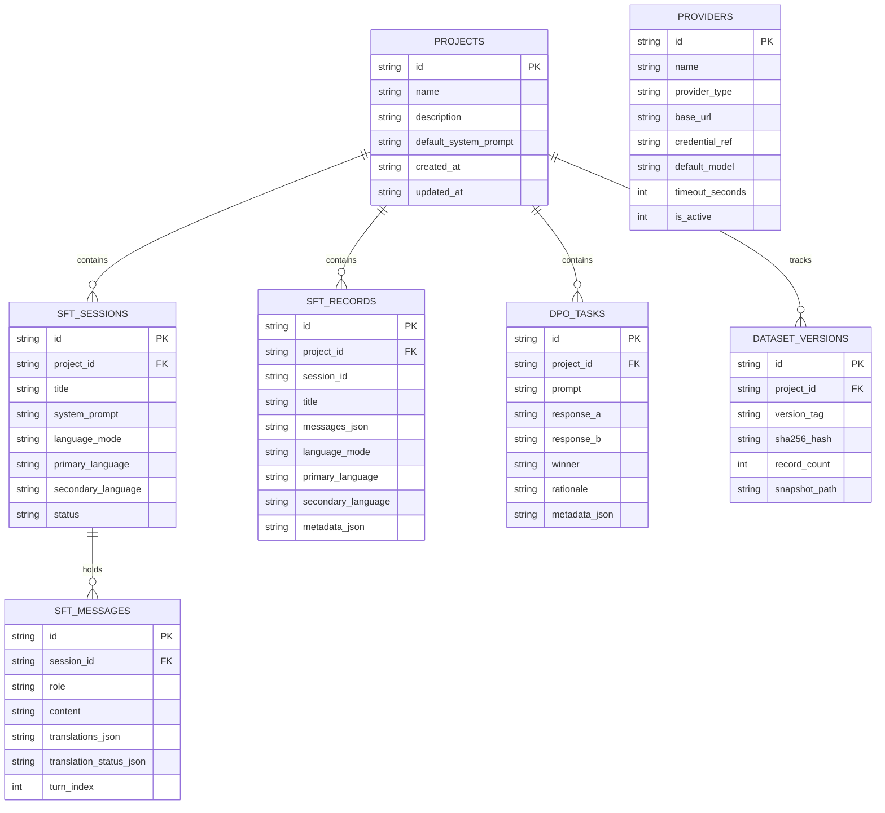

# Architecture Specification: Mechon AI

## 1. Architectural Philosophy

**Mechon AI** is an offline-first, local workstation engineered for AI dataset engineering, specializing in **Supervised Fine-Tuning (SFT)** and **Direct Preference Optimization (DPO)**.

### Core Architectural Principles:
1. **100% Native Desktop Architecture**:
   - Zero Python backend subprocesses or runtime dependencies.
   - Built entirely in **Rust** (Tauri 2 Core) and **TypeScript** (React 18 + Vite).
   - In-process native execution with sub-millisecond inter-process communication (IPC).
2. **Local-First & Data Sovereignty**:
   - Direct embedded **SQLite** storage with Write-Ahead Logging (WAL) and foreign keys.
   - All dataset records, drafts, annotations, and snapshots reside on local disk.
   - Zero telemetry, zero analytics beacons, zero mandatory internet connectivity.
3. **Atomic Dataset Records**:
   - In SFT, an entire multi-turn conversation draft commits as **exactly one atomic record** with an ordered array of turns (`messages: [...]`). Multi-turn dialogues are never split across loose database rows.
4. **Secure Credential Vault**:
   - API keys are never stored in plaintext within SQLite.
   - Direct integration with OS-native credential vaults (FreeDesktop Secret Service / KDE Wallet) via D-Bus, backed by an AES-256-GCM encrypted fallback when Secret Service is unavailable.

---

## 2. High-Level System Architecture



---

## 3. Subsystem Breakdown

### 3.1 Model Provider Architecture
The provider subsystem uses the **Provider Registry Pattern** with dedicated model adapters implementing the asynchronous `ModelProvider` trait:
- **`ModelProvider` Trait**: Exposes unified async interfaces for `generate()`, `stream()`, `test_connection()`, and `list_models()`.
- **Declarative Registry**: Single source of truth for provider metadata, default base URLs, model discovery strategies, and header builders.
- **Fail-Safe Isolation**: When generating dual candidates for DPO, candidates run in parallel via `tokio::join!`. A failure in candidate B never cancels or corrupts candidate A.

### 3.2 Secure Credential Vault (`HybridCredentialVault`)
- **Zero Plaintext Storage**: The SQLite database stores only a random UUID `credential_ref`. The actual API key is never written to SQLite plaintext columns.
- **Cross-Desktop FreeDesktop Secret Service**: Communicates over session D-Bus directly with the active Secret Service daemon (e.g. `kwalletd5`, `kwalletd6`, or `org.kde.secretservicecompat`).
- **Encrypted Local Fallback**: When Secret Service is locked or unavailable, credentials fall back transparently to an AES-256-GCM encrypted file (`~/.local/share/mechon-ai/vault.enc`) keyed to a persistent machine identifier.

### 3.3 Translation & Bilingual Dataset Engineering
- **Contextual Translation Engine**: Translates multi-turn conversation dialogues turn-by-turn with grounding on previous turns.
- **Turn-Level Approval Lifecycle**: Turns cycle through verified states: `pending` → `generated` → `edited` → `approved` (or `failed`).
- **Bilingual Export Projections**: Transforms canonical aligned records into:
  - `canonical_aligned`: Retains primary text and aligned translations.
  - `primary_only`: Drops translation metadata for primary language training.
  - `secondary_only`: Replaces prompt/turn contents with translated text for secondary language training.

### 3.4 Selective Export Engine
- Supports exporting individually selected conversation sessions and preference pairs from Mechon Corpus without exporting the entire database.
- Validates selections upfront to prevent blank file exports.
- Computes SHA-256 checksums across all written files for provenance verification.

### 3.5 Fine-Tuning Engineering & Certification Subsystem
Mechon AI incorporates a dedicated engineering engine following the principle **"Let the Engineers Control the Quality"**:

1. **Model-Aware Chat Template Engine (`ChatTemplateEngine`)**:
   - In-process Jinja2 template rendering powered by `minijinja`.
   - Curated template definitions for **Meta Llama 3/3.1/3.2/3.3**, **Alibaba Qwen 2.5**, **Google Gemma 2**, **Mistral Instruct/Nemo**, **Microsoft Phi-3/Phi-4**, and **ChatML**.
   - Strict role alternation checking, empty turn detection, and raw special token injection scanning (`<|end_of_text|>`, `<|im_end|>`, `<end_of_turn>`).
2. **Sequence Length Analytics & Truncation Simulation (`SequenceAnalyticsEngine`)**:
   - Model-aware multilingual BPE token estimation across CJK, Arabic, and Latin scripts.
   - Exact percentiles ($P_{50}$, $P_{90}$, $P_{95}$, $P_{99}$) and 10-bucket histogram distribution.
   - Multi-limit comparison matrix (1024, 2048, 4096, 8192, 16384, 32768) comparing retained vs clipped tokens without mutating source records.
3. **Deduplication & Near-Duplicate Clustering (`DeduplicationEngine`)**:
   - Three-tier detection: Exact SHA-256 hash, Normalized text hash, and Near-duplicate 3-gram Jaccard similarity.
   - Persistent engineer decisions (`retain`, `exclude`, `acceptable`) stored in `duplicate_review_decisions`.
4. **System Prompt & Persona Audit (`PersonaAuditEngine`)**:
   - Frequency clustering and persona dominance calculations.
   - Tone and instruction drift detection against configurable policies (`single_consistent_persona`, `multiple_intentional_personas`, `mixed_instruction`).
5. **Deterministic Train/Eval Splitting (`SplitEngine`)**:
   - SplitMix64 pseudo-random permutation guaranteed reproducible across machines with seed configuration.
   - Atomic group isolation: Multi-turn dialogues and near-duplicate groups are assigned together to guarantee **0 data leakage** between train and eval sets.
6. **Training Readiness Certification Report (`ReadinessEngine`)**:
   - 8-dimension pre-flight evaluation classifying datasets into `READY`, `READY_WITH_WARNINGS`, or `BLOCKED`.
   - Exportable to GitHub Flavored Markdown and JSON diagnostics.
7. **Conversational DPO Preference Serialization (`ConversationalDPOEngine`)**:
   - Full support for Hugging Face TRL multi-turn conversational schema (`prompt: [...]`, `chosen: [...]`, `rejected: [...]`).

---

## 4. Database Schema Specification

Mechon AI uses SQLite with automatic schema migration on startup.



---

## 5. Directory Layout & XDG Standards

Mechon AI strictly follows the **XDG Base Directory Specification**:

```text
~/.local/share/mechon-ai/
├── mechon.db                  # Primary SQLite 3 database (WAL mode)
├── mechon.db-wal              # Write-Ahead Logging journal
├── mechon.db-shm              # Shared memory index
├── vault.enc                  # AES-256-GCM encrypted fallback credential store
├── backups/                   # Hot online VACUUM INTO database backups
└── snapshots/                 # Cryptographic JSON version snapshots

~/.config/mechon-ai/
└── settings.json              # UI theme & layout configuration

~/.cache/mechon-ai/
└── exports/                   # Temporary export staging
```
