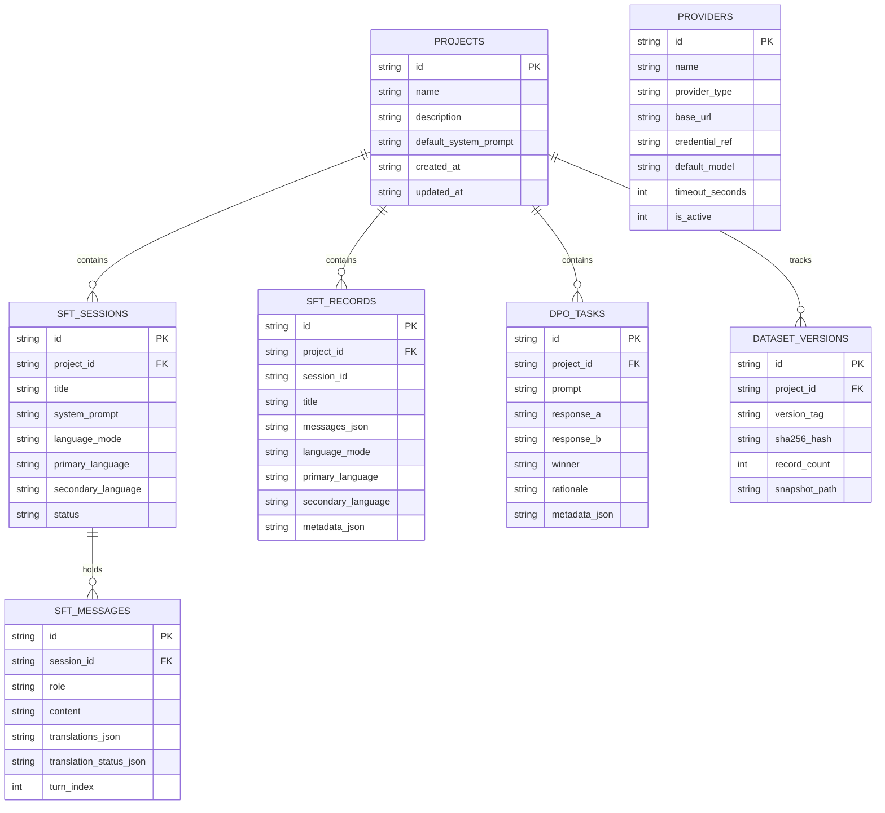

# Architecture Specification: Mechon AI

## 1. Architectural Philosophy

**Mechon AI** is an offline-first, local workstation engineered for AI dataset engineering, specializing in **Supervised Fine-Tuning (SFT)** and **Direct Preference Optimization (DPO)**.

### Core Architectural Principles:
1. **100% Native Desktop Architecture**:
   - Zero Python backend subprocesses or runtime dependencies.
   - Built entirely in **Rust** (Tauri 2 Core) and **TypeScript** (React 18 + Vite).
   - In-process native execution with sub-millisecond inter-process communication (IPC).
2. **Local-First & Data Sovereignty**:
   - Direct embedded **SQLite** storage with Write-Ahead Logging (WAL) and foreign keys.
   - All dataset records, drafts, annotations, and snapshots reside on local disk.
   - Zero telemetry, zero analytics beacons, zero mandatory internet connectivity.
3. **Atomic Dataset Records**:
   - In SFT, an entire multi-turn conversation draft commits as **exactly one atomic record** with an ordered array of turns (`messages: [...]`). Multi-turn dialogues are never split across loose database rows.
4. **Secure Credential Vault**:
   - API keys are never stored in plaintext within SQLite.
   - Direct integration with OS-native credential vaults (FreeDesktop Secret Service / KDE Wallet) via D-Bus, backed by an AES-256-GCM encrypted fallback when Secret Service is unavailable.

---

## 2. High-Level System Architecture

```mermaid
graph TD
    subgraph Frontend ["Frontend Shell (React 18 + TypeScript + Vite 6)"]
        UI_Dashboard["Dashboard & Workspace"]
        UI_SFT["Mechon SFT Studio<br/>Chat, Bilingual & Revision"]
        UI_DPO["Mechon DPO Studio<br/>Pairwise Evaluation"]
        UI_Story["Story Architect<br/>Planning & Agentic Authoring"]
        UI_Corpus["Mechon Corpus<br/>Explorer & Dataset Inspector"]
        UI_Export["Export Center<br/>Selective & Multilingual Export"]
        UI_Providers["Provider Manager<br/>Registry & Diagnostics"]
        UI_Engineering["Dataset Engineering<br/>Quality, Deduplication & Analytics"]
        UI_Layout["Workspace Layout Manager<br/>Resizable Panels & Persistent Ratios"]
        UI_State["Zustand Stores & TanStack Query"]
    end

    subgraph IPC ["Tauri 2 Native IPC Boundary"]
        Bridge["Type-Safe Tauri Commands"]
        Events["Tauri Event Bus<br/>Streaming, Progress & Agent Events"]
    end

    subgraph Rust_Core ["Native Rust Backend Core"]

        subgraph Authoring ["Dataset Authoring Services"]
            Svc_SFT["SFT Service<br/>Session & Atomic Commits"]
            Svc_DPO["DPO Service<br/>Dual Generation & Annotation"]
            Svc_Story["Story Planning Service<br/>Premise, Characters & Objectives"]
            Svc_Conversation["Conversation Engine<br/>Multi-Turn Context & Execution"]
            Svc_Revision["Revision Service<br/>Edit, Regenerate & Restore"]
        end

        subgraph Agentic ["Agentic Dataset Engineering Engine"]
            Planner["Planning Agent<br/>Story-to-Prompt Generation"]
            Context["Narrative Context Manager<br/>Continuity & Ground Truths"]
            Evaluator["Progress Evaluation Agent<br/>Milestone & Objective Tracking"]
            Approval["Human-in-the-Loop Controller<br/>Manual / Hybrid / Auto-Allow"]
            Orchestrator["Agent Orchestrator<br/>Autonomous Execution Loop"]
            Provenance["Agent Provenance Tracker<br/>Prompt & Generation History"]
        end

        subgraph Provider_System ["Model Provider Orchestration"]
            Config["Authoritative Provider Config<br/>Provider & Model Resolution"]
            Router["Provider Router<br/>Request Dispatch & Session Overrides"]
            Registry["Provider Registry"]
            Capabilities["Model Capability Registry<br/>Parameters & Protocol Support"]
            Diagnostics["Provider Diagnostics<br/>Health, Auth & Generation Tests"]
            Retry["Error & Retry Manager<br/>429, Timeout & Recovery"]

            Mock["Mock Adapter"]
            Ollama["Ollama Adapter"]
            Groq["Groq Adapter"]
            OpenAI["OpenAI-Compatible Adapter"]
            Anthropic["Anthropic Messages Adapter"]
            Streaming["Unified Streaming Engine<br/>Provider-Specific SSE Parsers"]
        end

        subgraph Data_Engineering ["Dataset Engineering Services"]
            Dataset["Dataset Service<br/>Corpus & Record Management"]
            Translation["Translation Service<br/>Dynamic Language Pairs"]
            Export["Export Service<br/>JSONL, JSON, CSV & TXT"]
            Validation["Quality Validation Service<br/>Schema & Structural Audits"]
            Dedup["Deduplication Engine"]
            Analytics["Sequence & Dataset Analytics"]
            Versioning["Dataset Versioning<br/>SHA-256 Snapshots & Rollback"]
        end

        subgraph Security ["Security & Credential Vault"]
            Vault["HybridCredentialVault"]
            Secret["FreeDesktop Secret Service / KWallet"]
            AES["AES-256-GCM Encrypted Fallback"]
        end

        subgraph Storage ["Persistent Storage"]
            Pool["SQLx Connection Pool<br/>WAL & Foreign Keys"]
            DB[("SQLite Database")]
            FileStore["Local Dataset & Backup Storage"]
        end
    end

    UI_Dashboard --> Bridge
    UI_SFT --> Bridge
    UI_DPO --> Bridge
    UI_Story --> Bridge
    UI_Corpus --> Bridge
    UI_Export --> Bridge
    UI_Providers --> Bridge
    UI_Engineering --> Bridge
    UI_Layout --> Bridge

    Bridge --> Svc_SFT
    Bridge --> Svc_DPO
    Bridge --> Svc_Story
    Bridge --> Svc_Conversation
    Bridge --> Svc_Revision
    Bridge --> Dataset
    Bridge --> Translation
    Bridge --> Export
    Bridge --> Validation
    Bridge --> Diagnostics

    Svc_Story --> Planner
    Planner --> Context
    Context --> Evaluator
    Evaluator --> Approval
    Approval --> Orchestrator
    Orchestrator --> Svc_Conversation
    Svc_Conversation --> Planner

    Orchestrator --> Provenance
    Svc_Conversation --> Provenance
    Svc_Revision --> Provenance

    Approval --> Events
    Orchestrator --> Events
    Streaming --> Events
    Events --> UI_State

    Svc_SFT --> Router
    Svc_DPO --> Router
    Translation --> Router
    Planner --> Router
    Svc_Conversation --> Router
    Svc_Revision --> Router

    Config --> Router
    Router --> Registry
    Registry --> Capabilities
    Registry --> Mock
    Registry --> Ollama
    Registry --> Groq
    Registry --> OpenAI
    Registry --> Anthropic

    Registry --> Streaming
    Router --> Retry
    Router --> Vault
    Diagnostics --> Registry

    Svc_SFT --> Dataset
    Svc_Conversation --> Dataset
    Svc_Revision --> Dataset
    Dataset --> Validation
    Dataset --> Dedup
    Dataset --> Analytics
    Dataset --> Versioning
    Dataset --> Export

    Translation --> Dataset
    Validation --> Versioning
    Versioning --> FileStore
    Export --> FileStore

    Router --> Pool
    Svc_SFT --> Pool
    Svc_DPO --> Pool
    Svc_Story --> Pool
    Svc_Conversation --> Pool
    Svc_Revision --> Pool
    Dataset --> Pool
    Translation --> Pool
    Versioning --> Pool
    Pool --> DB

    Vault --> Secret
    Vault --> AES
```



---

## 3. Subsystem Breakdown

### 3.1 Model Provider Architecture
The provider subsystem uses the **Provider Registry Pattern** with dedicated model adapters implementing the asynchronous `ModelProvider` trait:
- **`ModelProvider` Trait**: Exposes unified async interfaces for `generate()`, `stream()`, `test_connection()`, and `list_models()`.
- **Declarative Registry**: Single source of truth for provider metadata, default base URLs, model discovery strategies, and header builders.
- **Fail-Safe Isolation**: When generating dual candidates for DPO, candidates run in parallel via `tokio::join!`. A failure in candidate B never cancels or corrupts candidate A.

### 3.2 Secure Credential Vault (`HybridCredentialVault`)
- **Zero Plaintext Storage**: The SQLite database stores only a random UUID `credential_ref`. The actual API key is never written to SQLite plaintext columns.
- **Cross-Desktop FreeDesktop Secret Service**: Communicates over session D-Bus directly with the active Secret Service daemon (e.g. `kwalletd5`, `kwalletd6`, or `org.kde.secretservicecompat`).
- **Encrypted Local Fallback**: When Secret Service is locked or unavailable, credentials fall back transparently to an AES-256-GCM encrypted file (`~/.local/share/mechon-ai/vault.enc`) keyed to a persistent machine identifier.

### 3.3 Translation & Bilingual Dataset Engineering
- **Contextual Translation Engine**: Translates multi-turn conversation dialogues turn-by-turn with grounding on previous turns.
- **Turn-Level Approval Lifecycle**: Turns cycle through verified states: `pending` → `generated` → `edited` → `approved` (or `failed`).
- **Bilingual Export Projections**: Transforms canonical aligned records into:
  - `canonical_aligned`: Retains primary text and aligned translations.
  - `primary_only`: Drops translation metadata for primary language training.
  - `secondary_only`: Replaces prompt/turn contents with translated text for secondary language training.

### 3.4 Selective Export Engine
- Supports exporting individually selected conversation sessions and preference pairs from Mechon Corpus without exporting the entire database.
- Validates selections upfront to prevent blank file exports.
- Computes SHA-256 checksums across all written files for provenance verification.

### 3.5 Fine-Tuning Engineering & Certification Subsystem
Mechon AI incorporates a dedicated engineering engine following the principle **"Let the Engineers Control the Quality"**:

1. **Model-Aware Chat Template Engine (`ChatTemplateEngine`)**:
   - In-process Jinja2 template rendering powered by `minijinja`.
   - Curated template definitions for **Meta Llama 3/3.1/3.2/3.3**, **Alibaba Qwen 2.5**, **Google Gemma 2**, **Mistral Instruct/Nemo**, **Microsoft Phi-3/Phi-4**, and **ChatML**.
   - Strict role alternation checking, empty turn detection, and raw special token injection scanning (`<|end_of_text|>`, `<|im_end|>`, `<end_of_turn>`).
2. **Sequence Length Analytics & Truncation Simulation (`SequenceAnalyticsEngine`)**:
   - Model-aware multilingual BPE token estimation across CJK, Arabic, and Latin scripts.
   - Exact percentiles ($P_{50}$, $P_{90}$, $P_{95}$, $P_{99}$) and 10-bucket histogram distribution.
   - Multi-limit comparison matrix (1024, 2048, 4096, 8192, 16384, 32768) comparing retained vs clipped tokens without mutating source records.
3. **Deduplication & Near-Duplicate Clustering (`DeduplicationEngine`)**:
   - Three-tier detection: Exact SHA-256 hash, Normalized text hash, and Near-duplicate 3-gram Jaccard similarity.
   - Persistent engineer decisions (`retain`, `exclude`, `acceptable`) stored in `duplicate_review_decisions`.
4. **System Prompt & Persona Audit (`PersonaAuditEngine`)**:
   - Frequency clustering and persona dominance calculations.
   - Tone and instruction drift detection against configurable policies (`single_consistent_persona`, `multiple_intentional_personas`, `mixed_instruction`).
5. **Deterministic Train/Eval Splitting (`SplitEngine`)**:
   - SplitMix64 pseudo-random permutation guaranteed reproducible across machines with seed configuration.
   - Atomic group isolation: Multi-turn dialogues and near-duplicate groups are assigned together to guarantee **0 data leakage** between train and eval sets.
6. **Training Readiness Certification Report (`ReadinessEngine`)**:
   - 8-dimension pre-flight evaluation classifying datasets into `READY`, `READY_WITH_WARNINGS`, or `BLOCKED`.
   - Exportable to GitHub Flavored Markdown and JSON diagnostics.
7. **Conversational DPO Preference Serialization (`ConversationalDPOEngine`)**:
   - Full support for Hugging Face TRL multi-turn conversational schema (`prompt: [...]`, `chosen: [...]`, `rejected: [...]`).

---

## 4. Database Schema Specification

Mechon AI uses SQLite with automatic schema migration on startup.



---

## 5. Directory Layout & XDG Standards

Mechon AI strictly follows the **XDG Base Directory Specification**:

```text
~/.local/share/mechon-ai/
├── mechon.db                  # Primary SQLite 3 database (WAL mode)
├── mechon.db-wal              # Write-Ahead Logging journal
├── mechon.db-shm              # Shared memory index
├── vault.enc                  # AES-256-GCM encrypted fallback credential store
├── backups/                   # Hot online VACUUM INTO database backups
└── snapshots/                 # Cryptographic JSON version snapshots

~/.config/mechon-ai/
└── settings.json              # UI theme & layout configuration

~/.cache/mechon-ai/
└── exports/                   # Temporary export staging
```


---

## 6. Modular Editor UI Architecture (v1.2.0)

Mechon AI v1.2.0 transforms from a traditional dashboard into a high-density, modular **Integrated Development Environment (IDE) for AI Dataset Engineering**.

### A. The 5-Region Editor Shell

```text
+---------------------------------------------------------------------------------------------------------+
| Main Menu Bar: File  Edit  View  Project  Tools  Window  Help                                           |
+---------------------------------------------------------------------------------------------------------+
| Toolbar: [Project: default] [Layout: Preset ▼] [Quick Save] [Undo/Redo] [Ctrl+Shift+P] [Agent: Ready]    |
+-------------------+---------------------------------------------------------------+---------------------+
| PROJECT EXPLORER  | CENTRAL WORKSPACE (Multi-Tab Docking)                         | PROPERTY INSPECTOR  |
|                   | [Corpus] [Story Architect] [SFT Studio] [Forge] [+]           |                     |
| - Active Project  |---------------------------------------------------------------+ Context-aware:      |
|   - SFT Drafts    |                                                               | - Dataset Records   |
|   - DPO Tasks     |                                                               | - Conversations     |
|   - Corpus Recs   | (Active tab content with persistent keep-alive state)          | - Agent Configs     |
| - Studios & Tools |                                                               | - Providers         |
|   - Story Arch    |                                                               | - Project Metadata  |
|   - SFT Studio    |                                                               |                     |
|   - DPO Studio    +---------------------------------------------------------------+                     |
|   - Dataset Forge | BOTTOM PANEL (Collapsible, Resizable Splitter)               |                     |
|   - Engineering   | [Console] [Agent Logs] [Diagnostics] [Tasks] [Preview] [QC]   |                     |
+-------------------+---------------------------------------------------------------+---------------------+
```

### B. Workspace Layout Presets & Persistence

1. **Dataset Engineering**: Explorer (Left), Corpus / Dataset Editor (Center), Inspector (Right), Dataset Preview (Bottom).
2. **Agent Engineering**: Explorer (Left), Story Architect (Center), Agent Inspector (Right), Agent Logs (Bottom).
3. **SFT Engineering**: Explorer (Left), SFT Studio (Center), Conversation Inspector (Right), Dataset Preview (Bottom).
4. **DPO Evaluation**: Explorer (Left), DPO Studio (Center), Candidate Config Inspector (Right), Inference Logs (Bottom).
5. **Quality Assurance**: Explorer / Corpus (Left), Quality Control (Center), Validation Inspector (Right), Diagnostics (Bottom).
6. **Provider Engineering**: Provider Explorer (Left), Model Playground (Center), Provider Inspector (Right), Diagnostics (Bottom).
7. **Custom User Presets**: Users can resize splitters, dock/collapse panels, and save custom named workspace layouts to versioned local storage.

### C. Centralized Command Registry & Keyboard Engine

- **Command Palette (`Ctrl+Shift+P`)**: Searchable global command palette executing commands across all 7 categories without navigating away from the active editor.
- **Keyboard Shortcut Manager**:
  - `Ctrl+Shift+P`: Command Palette
  - `Ctrl+P`: Quick Open
  - `Ctrl+S` / `Ctrl+Shift+S`: Quick Save / Save All
  - `Ctrl+W`: Close Active Tab
  - `Ctrl+Tab` / `Ctrl+Shift+Tab`: Next / Previous Tab
  - `Ctrl+B`: Toggle Project Explorer
  - `Ctrl+Shift+I`: Toggle Property Inspector
  - `Ctrl+J`: Toggle Bottom Console & Logs
  - `F11`: Fullscreen Toggle
  - `Ctrl+,`: Preferences / Settings
  - `Ctrl+/`: Keyboard Shortcuts Reference Modal
