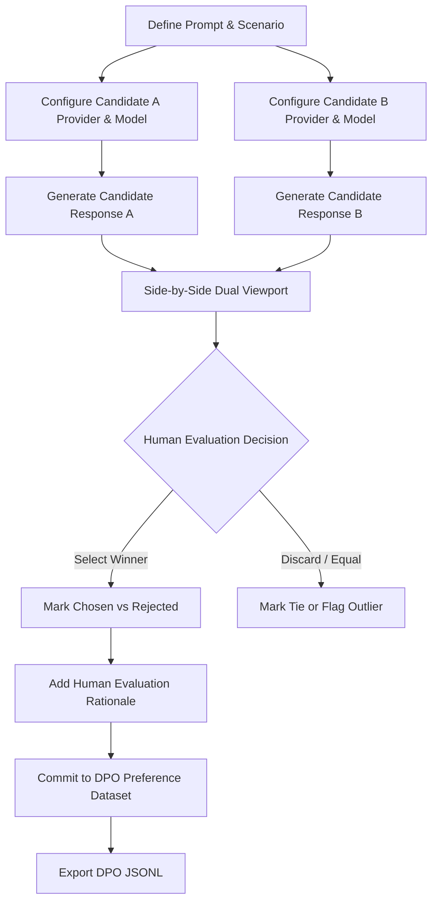

# DPO Studio: Direct Preference Optimization
**Version 1.2.8 | Mechon AI Fine-Tuning Workstation**

**DPO Studio** is Mechon AI's dedicated preference dataset authoring environment. It provides a structured, side-by-side workflow for generating, comparing, annotating, and exporting preference pairs for Direct Preference Optimization (DPO), Reinforcement Learning from Human Feedback (RLHF), and Kahneman-Tversky Optimization (KTO).

---

## 1. DPO Workflow



---

## 2. Dual-Model Generation & Comparison

1. **Prompt Entry**: Input a prompt representing an instruction, reasoning problem, or dialogue turn.
2. **Independent Candidate Routing**:
   - **Candidate A**: Can be assigned any available provider (e.g., local Ollama LLaMA 3.1 8B).
   - **Candidate B**: Can be assigned a completely distinct provider and model (e.g., Anthropic Claude 3.5 Sonnet or OpenAI GPT-4o).
   - Alternatively, evaluate two different system prompts or sampling temperatures using the same model.
3. **Simultaneous Generation**: Trigger dual generation to produce both candidate completions in parallel.
4. **Side-by-Side Inspection**: Review responses in a high-density, diff-friendly split pane with markdown formatting, syntax highlighting, and token metrics.

---

## 3. Human Preference Judgments & Rationale

Dataset engineers make explicit evaluation decisions:
- **Choose Winner**: Mark Candidate A or Candidate B as **Chosen**; the unselected response automatically becomes **Rejected**.
- **Tie**: Record that both responses provided equivalent utility or accuracy.
- **Flag Outlier**: Flag responses that exhibited safety violations, hallucination, or truncation.
- **Human Rationale**: Document *why* the chosen response was preferred (e.g., *"Candidate A correctly handled the subtle negative constraint and avoided hallucinating a nonexistent API parameter"*). This rationale is preserved in the preference record.

---

## 4. DPO Dataset Schema & Export

Committed preference records are stored in the local SQLite database and exported via the Export Center as DPO JSONL:

```json
{
  "id": "dpo_78f1a23c-91b4-4b52-9c12-3847529a1b41",
  "prompt": "Explain the difference between SFT and DPO in machine learning.",
  "chosen": "Supervised Fine-Tuning (SFT) trains a model on high-quality demonstration pairs (prompt -> target) using cross-entropy loss. Direct Preference Optimization (DPO) aligns a model directly on paired preferences (prompt -> chosen vs rejected) using an implicit reward formulation without needing a separate reward model.",
  "rejected": "SFT and DPO are basically the same thing but DPO is newer and uses reinforcement learning with a separate reward model.",
  "rationale": "Chosen response accurately contrasts the loss formulations and correctly identifies that DPO eliminates the separate reward model.",
  "model_a": "claude-3-5-sonnet",
  "model_b": "ollama/llama3-8b",
  "created_at": "2026-11-04T12:00:00Z"
}
```

This format is directly compatible with HuggingFace TRL `DPOTrainer` and modern alignment frameworks.
