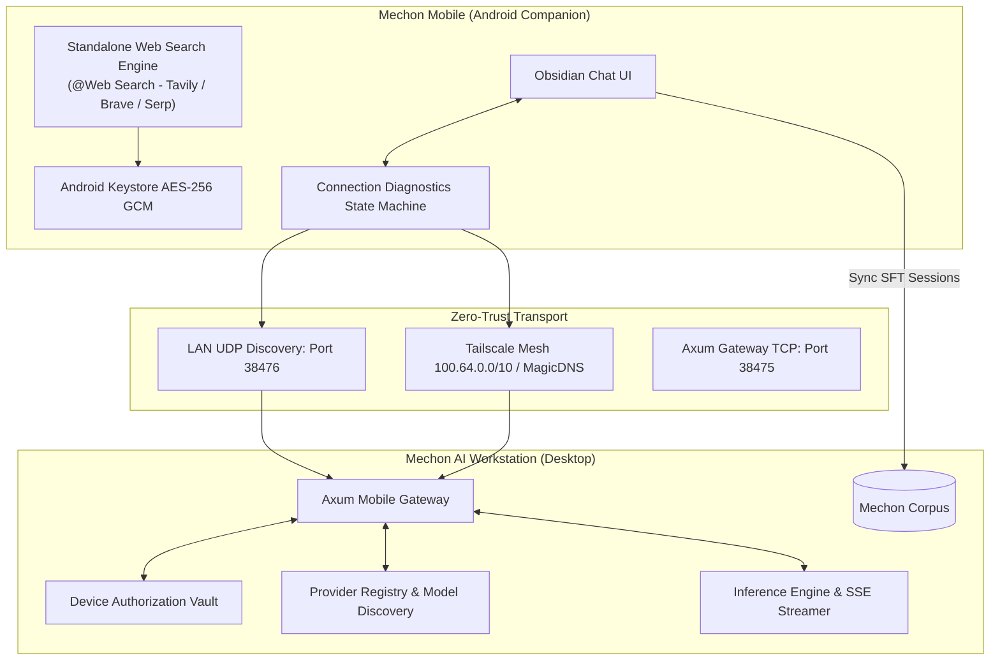

# Mechon Mobile: Android Companion & Remote Inference
**Version 1.2.8 | Android Package: `ai.mechon.companion`**

**Mechon Mobile** is the native Android companion application for Mechon AI. Built with Jetpack Compose, Material 3, and Kotlin coroutines, it extends the desktop engineering workstation to mobile devices, allowing dataset engineers to author, test, and harvest conversational demonstrations wherever they are.

---

## 1. System Architecture & Credential Sovereignty



### Architectural Principles

1. **Desktop Owns LLM Providers & Credentials**:
   - The Android companion does **not** manage LLM API keys or connect directly to AI model providers.
   - Instead, the desktop workstation acts as the central inference gateway. Mobile inherits all providers, local Ollama models, and cloud credentials already configured on desktop.
2. **Desktop Owns Device Authorization**:
   - Every mobile device must be approved on the desktop workstation.
   - Approved devices are issued a cryptographic session bearer token. Unapproved devices receive HTTP 403 Forbidden.
3. **Standalone Mobile Web Search**:
   - Web Search operates **independently** on Android, with no dependency on desktop availability or LLM providers.
   - Web search API keys (Tavily, Brave, SerpAPI, SearXNG) are encrypted using Android Keystore AES-256 GCM in a separate mobile secure preferences file.

---

## 2. Pairing & Connection Lifecycle

Mechon Mobile implements a strict 14-state verified connection machine adhering to the invariant:

$$\text{APPROVED} \neq \text{CONNECTED} \neq \text{READY}$$

A device is only marked with the green **READY** status when all 7 application stages pass verification:

```
[1/7] TCP Port Reachability (38475)   ==> OK
[2/7] Session Token Authentication     ==> OK
[3/7] Machine Identity Handshake       ==> OK
[4/7] Desktop Service Health           ==> OK
[5/7] API Capabilities Negotiation     ==> OK
[6/7] Active Provider Check (>= 1)     ==> OK
[7/7] Available Models Discovered (>0) ==> OK
```

### Connectivity Options
- **LAN Zero-Configuration Discovery**: Automated UDP discovery beacons broadcast across port `38476` with `WifiManager.MulticastLock` support.
- **Tailscale Mesh**: Direct peer-to-peer connection over Tailscale CGNAT IPs (`100.64.0.0/10`) or MagicDNS (`*.ts.net`) without port forwarding or exposed public endpoints.
- **Connection Diagnostics Dialog**: Accessible from the mobile top bar to inspect each verification stage in real time with troubleshooting tips.

---

## 3. Conversational AI Experience & Roleplay Studio

Mechon Mobile features a dark **Obsidian Visual Identity**:
- **Streaming Responses**: Real-time Server-Sent Events (SSE) streaming with live token generation metrics.
- **Message Action Bar**: Copy, edit, regenerate, delete, and stop in-flight generation.
- **Vision Attachments**: Image and document picker with vision model compatibility checks.
- **Roleplay Studio**: 10 modular configuration sections, dynamic character presets, and custom prompt injection.
- **`@Web Search <query>`**: Invoke factual web search grounding with expandable Obsidian source citation cards.

---

## 4. Mobile-to-Desktop SFT Transfer Pipeline

1. Author multi-turn conversations on Android.
2. Open the **Sync Drawer** and select conversations to transfer.
3. Tap **Transfer to Desktop**.
4. The sessions are transmitted securely over `/api/mobile/v1/sessions/sync` into the desktop workspace.
5. In Mechon AI Desktop, open **SFT Studio** $\rightarrow$ *Load from Corpus* to inspect, edit, translate into other languages, and export the dataset.
