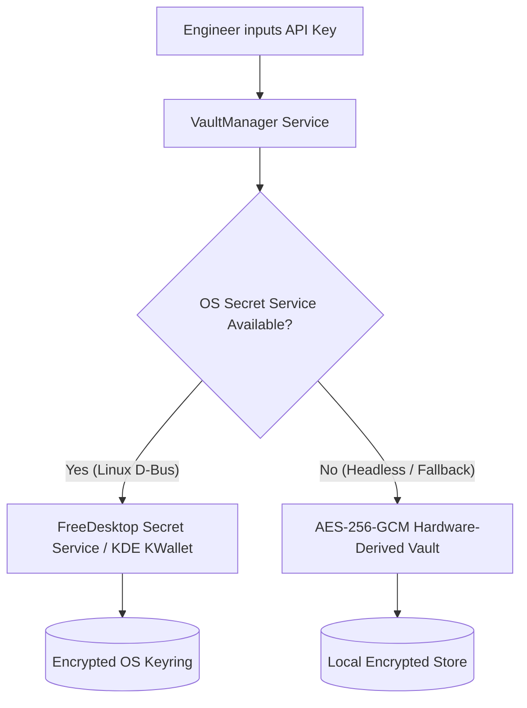

# Security, Privacy & Credential Isolation
**Version 1.2.8 | Mechon AI Fine-Tuning Workstation**

Security and privacy are fundamental architectural pillars of Mechon AI. Because dataset engineering often involves sensitive proprietary knowledge, pre-release model outputs, and custom corporate corpora, Mechon AI is built from the ground up to guarantee local-first data sovereignty.

---

## 1. Local-First & Zero-Telemetry Invariant

- **Zero Phone-Home / Analytics**: Mechon AI contains zero telemetry beacons, crash reporters, usage trackers, or third-party analytics scripts.
- **Local SQLite Storage**: All conversation drafts, SFT records, DPO preference annotations, project configurations, and metadata are persisted exclusively to local SQLite databases on your machine.
- **Offline Capable**: Combined with local Ollama runtime, Mechon AI can operate in a 100% air-gapped environment with no internet access.

---

## 2. Desktop Credential Vault Architecture

API keys for remote inference providers (OpenAI, Anthropic, Google Gemini, Groq, Mistral, OpenRouter) are never stored in plaintext.

1. **FreeDesktop Secret Service / KWallet Integration**:
   - On Linux desktops, keys are dispatched via D-Bus IPC directly to the native keyring (GNOME Keyring, KWallet, or keepassxc).
   - Keys are decrypted only in memory when actively constructing an outbound inference request.
2. **AES-256-GCM Fallback**:
   - If the system lacks an active Secret Service daemon, credentials are encrypted using AES-256 in Galois/Counter Mode (GCM).
   - Encryption keys are derived using PBKDF2/Argon2 from machine-specific hardware identifiers (motherboard UUID, machine-id), preventing database copying across machines.

---

## 3. Mobile Gateway & Zero-Trust Pairing

The Mechon Mobile Companion connects to the desktop workstation over an authenticated zero-trust gateway:

1. **Explicit Device Approval Handshake**:
   - A newly discovered mobile device cannot immediately execute inference or access records.
   - The desktop displays an authorization prompt showing the mobile device name, client IP, and fingerprint.
   - Only when the engineer explicitly clicks **Approve** is a cryptographic session bearer token minted.
2. **Access Control Invariants**:
   - Unapproved or revoked device tokens receive HTTP 403 Forbidden.
   - Expired or malformed tokens receive HTTP 401 Unauthorized.
   - The mobile client validates connection health across 7 application stages before declaring readiness.
3. **Tailscale Mesh Encryption**:
   - When connecting outside the local Wi-Fi network, connections traverse Tailscale's WireGuard mesh (`100.64.0.0/10`), ensuring end-to-end encryption without exposing open ports to the public internet.

---

## 4. Mobile Standalone Web Search Isolation

Mechon Mobile includes an independent web search engine (`@Web Search`):
- **Isolated Android Keystore Vault**: Web search provider keys (Tavily, Brave, SerpAPI) are stored in a dedicated `mechon_web_search_secure_prefs` store encrypted with Android Keystore hardware-backed AES-256 GCM.
- **Zero Cross-Contamination**: Web search API keys are never transmitted to the desktop workstation and are never written into SFT dataset records or training corpus files.
