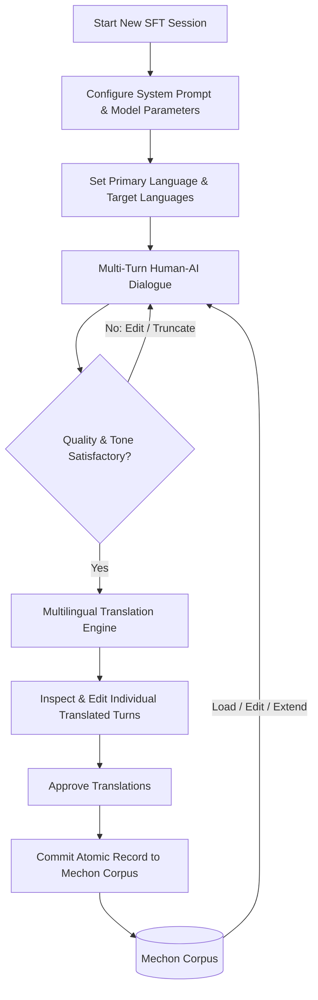

# SFT Studio: Interactive Multi-Turn Dataset Engineering
**Version 1.2.8 | Mechon AI Fine-Tuning Workstation**

**SFT Studio** is the central interactive conversation engineering environment in Mechon AI. It enables machine learning engineers to create, curate, refine, and translate multi-turn conversational datasets for Supervised Fine-Tuning (SFT).

In Mechon AI, conversations are treated as **atomic multi-turn dataset records**, not isolated prompt-response pairs. A single record captures the complete contextual flow, role transitions, and instruction-following dynamics required for state-of-the-art chat model alignment.

---

## 1. Conversational Engineering Workflow

### Step 1: Initialize Session & Define Behavior
- Create a session associated with the active project workspace.
- Configure the **System Instructions** to enforce behavioral rules, tone, formatting conventions, or safety guidelines.
- Select the active **Provider** (e.g., Ollama, Google Gemini, Anthropic Claude, OpenAI, Groq) and **Model**.
- Fine-tune inference hyper-parameters: Temperature, Top-P, Context Limit, and Max Completion Tokens.

### Step 2: Multi-Turn Dialogue
- Converse freely with the model across unlimited conversational turns.
- Test edge cases, reasoning steps, code generation, creative writing, or technical Q&A.
- Use live token counters to track token consumption against context limits.

### Step 3: Granular In-Flight Curation
- **Edit Message**: Click the edit icon on any human or assistant message to fix typos, improve factual accuracy, or refine tone.
- **Regenerate Response**: Request an alternative completion from the selected model.
- **Downstream Truncation**: Truncate all turns after a designated point to re-route a conversation that took an undesirable trajectory.
- **Role Switching**: Inspect and toggle message roles (`user`, `assistant`, `system`) if curating synthetic multi-agent demonstrations.

---

## 2. Multilingual Engineering & Translation Engine

Mechon AI features an integrated LLM-powered translation engine designed for multilingual dataset engineering:

### Language Configuration
- **Primary Language**: The source language of the conversation (e.g., English, Indonesian, Japanese, French).
- **Target Language(s)**: One or more secondary languages configured for parallel translation.

### Translation Execution
1. Open the **Translation Modal** from the SFT Studio toolbar.
2. Select any discovered LLM model to serve as the translation agent (e.g., Gemini 2.5 Pro or Claude 3.5 Sonnet for nuanced cross-lingual nuance).
3. The translation engine iterates through all turns, translating user prompts and assistant responses while preserving code blocks, markdown tags, and formatting anchors.
4. **Side-by-Side Review**: Inspect the original and translated messages turn-by-turn.
5. **Turn-Level Regeneration**: Regenerate any specific turn if the phrasing needs adjustment.
6. **Manual Correction**: Edit translated text directly in the review dialog before approval.

---

## 3. Atomic Commitment to Mechon Corpus

When the conversation reaches the desired quality:
1. Click **Commit to SFT Dataset**.
2. Mechon AI bundles the entire conversation, system prompt, turn order, primary language, and multilingual translations into **one atomic record**.
3. The record is persisted to embedded SQLite storage with an immutable timestamp and assigned record ID.

---

## 4. Iterative Lifecycle: Loading from Corpus

Dataset engineering is an iterative process. Saved records are never locked in static storage:
- Open the **Load from Corpus** drawer in SFT Studio.
- Search and filter existing SFT records by tag, language, or content.
- Load any record back into SFT Studio.
- Continue the conversation with additional turns, update system instructions, add new language translations, and recommit the updated record back to Corpus.
