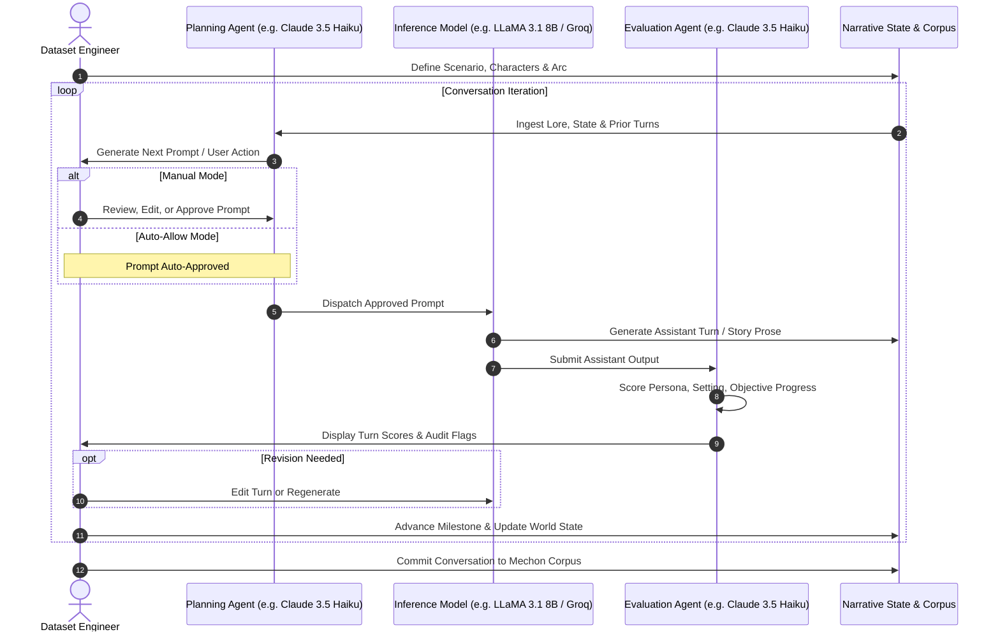
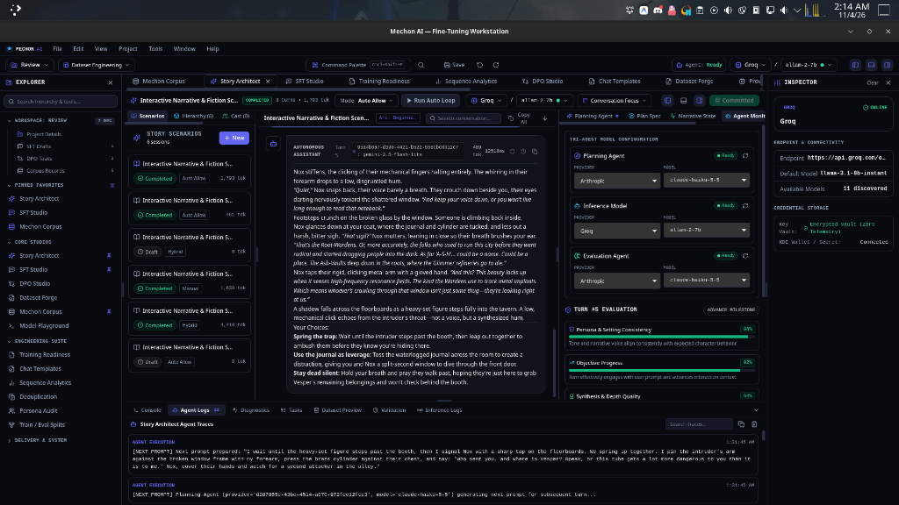

# Story Architect: Agentic Conversation Engineering
**Version 1.2.8 | Mechon AI Fine-Tuning Workstation**

Story Architect is an agentic conversation engineering environment built directly into Mechon AI. It enables machine learning engineers and dataset curators to design, simulate, evaluate, and harvest complex, high-depth narrative and roleplay conversations for Supervised Fine-Tuning (SFT).

Rather than writing multi-turn synthetic data manually or relying on unguided LLM generation, Story Architect implements a continuous, human-steered agentic loop with dedicated planning, inference, and evaluation roles.

---

## 1. Tri-Agent Architecture

Story Architect orchestrates three independently configurable agents to drive each conversational milestone:

### The Three Agents in Detail

1. **Planning Agent**:
   - **Role**: World director, scenario simulator, and user-turn generator.
   - **Responsibilities**: Ingests narrative goals, world lore, character constraints, and conversation history to prepare the next prompt or user turn. It advances plot milestones and creates realistic, challenging interaction contexts.
   - **Engine Support**: Independently configurable (e.g., Anthropic Claude 3.5 Haiku, OpenAI GPT-4o-mini, Groq LLaMA).

2. **Inference Model (Story / Roleplay Agent)**:
   - **Role**: Target model under evaluation or synthetic dialogue producer.
   - **Responsibilities**: Generates the in-character narrative response, dialogue, or complex instruction execution based on the planning prompt and system instructions.
   - **Engine Support**: Can point to local offline models (Ollama LLaMA 3, Mistral) or cloud endpoints (Groq, Anthropic, Gemini, OpenRouter).

3. **Evaluation Agent**:
   - **Role**: Quality gatekeeper and real-time alignment auditor.
   - **Responsibilities**: Evaluates each generated assistant turn across three quantitative metrics:
     - **Persona & Setting Consistency**: Adherence to character voice, tone, temporal world rules, and physical constraints.
     - **Objective Progress**: Whether the turn advanced the scenario's active narrative milestone or resolved dialogue tension.
     - **Synthesis & Depth Quality**: Prose richness, vocabulary variety, emotional resonance, and avoidance of clichés.
   - **Feedback**: Provides real-time percentage ratings and flags out-of-character drift before the conversation is accepted into the training corpus.

---

## 2. Tri-Agent Model Configuration & Inspector

As visible in the Story Architect UI, the right dock features the **Tri-Agent Model Configuration** panel:

Each agent can be assigned distinct providers and models based on performance, cost, and latency requirements:
- Use fast, low-cost models for the **Planning Agent** (e.g. Groq LLaMA 3.1 8B or Claude 3.5 Haiku).
- Use your target frontier model for the **Inference Model** (e.g. Gemini 2.5 Pro, LLaMA 70B, Claude 3.5 Sonnet).
- Use an objective auditor for the **Evaluation Agent**.

---

## 3. Workflow & Human-in-the-Loop Controls

Story Architect provides granular control over automation versus curation:

### Execution Modes
- **Manual Mode**: The Planning Agent generates a candidate prompt. The engineer inspects, rewrites, or approves it before the Inference Model executes.
- **Auto-Allow Mode**: The workflow runs automatically. Each generated prompt is auto-approved, fed to the Inference Model, and evaluated. The loop halts only when a target turn count or milestone is reached, or when the Evaluation Agent flags a low-score turn.
- **Run Auto Loop**: Executes a defined sequence of turns while displaying live token generation and trace logs.

### Revision & Regeneration
- **Turn Editing**: Hover over any message in the central conversation viewport to edit the text directly.
- **Downstream Truncation**: Truncate downstream messages from any point to redirect the narrative arc if the story drifted.
- **Regenerate Single Turn**: Request alternative completions from the Inference Model with adjusted sampling temperature or top-p.

---

## 4. Integration with Mechon Corpus & SFT Studio

A completed Story Architect session is not an isolated artifact—it is an integral part of the Mechon dataset lifecycle:

1. **Commit to Corpus**:
   - Click **Commit** in the Story Architect header.
   - The entire multi-turn narrative session is stored in SQLite as **one atomic multi-turn SFT record**, retaining its character metadata, scenario tags, and turn count.
2. **Bridge to SFT Studio**:
   - Any committed story conversation can be opened in **Mechon SFT Studio** via the *Load from Corpus* drawer.
   - In SFT Studio, engineers can extend the dialogue, edit system prompts, or initiate **Multilingual Translation** to translate the story into secondary and tertiary languages.
3. **Re-commit & Export**:
   - After multilingual translation or further manual refinement, update the record in Mechon Corpus and export it via the Export Center.
